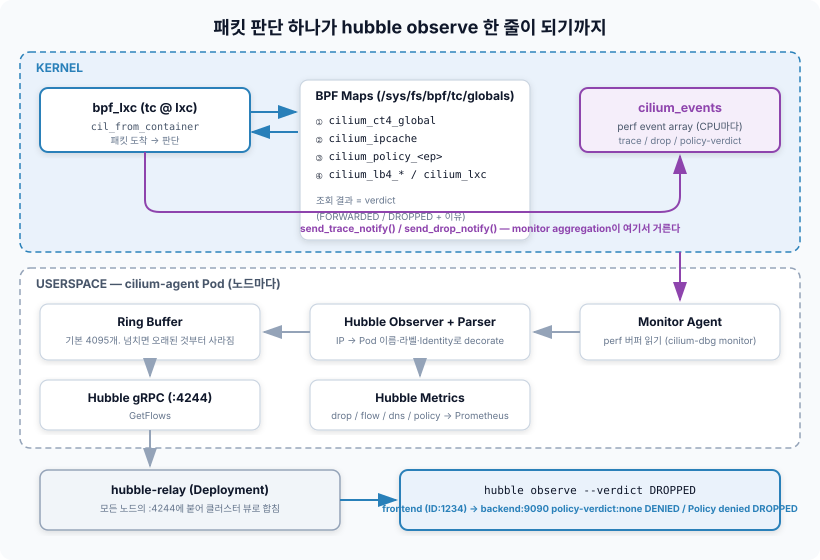

# Week 7. eBPF Deep Dive & Hubble

Week 5에서 Cilium이 동작하는 클러스터를 따라가며 마지막에 이렇게 정리했다. **에이전트는 프로그램과 맵을 등록하는 유저스페이스 도구이고, 등록이 끝나면 패킷 경로에서 빠진다.** 정말 빠지는지 확인해 봤다. Pod 둘 사이에 핑을 걸어 두고 그 노드의 에이전트를 죽였다.

```bash
$ kubectl exec client -- ping -i 0.2 10.42.1.7 &
$ kubectl -n kube-system delete pod cilium-x7k2p      # client가 떠 있는 노드의 에이전트
pod "cilium-x7k2p" deleted

64 bytes from 10.42.1.7: icmp_seq=118 ttl=63 time=0.412 ms
64 bytes from 10.42.1.7: icmp_seq=119 ttl=63 time=0.398 ms   # 에이전트가 없는 동안에도
64 bytes from 10.42.1.7: icmp_seq=120 ttl=63 time=0.405 ms   # 끊기지 않는다
```

핑은 한 번도 안 끊겼다. 정책도 그대로 먹었다. 막혀 있던 `9090` 포트는 에이전트가 없는 동안에도 계속 막혀 있었다. 그런데 Week 5에서 쓰던 명령으로 프로그램을 찾아보면 이상한 게 하나 더 나온다.

```bash
$ tc filter show dev lxc1a2b3c4d5e6f ingress
$                                                     # 아무것도 없다
```

커널 6.6 이상 노드에서는 `tc filter`에 Cilium 프로그램이 **안 보인다.** 그런데 패킷은 판단을 받고 있다. 그러면 질문이 둘이다.

- 프로그램과 맵은 에이전트 프로세스가 죽었는데 **누가 붙잡고 있길래** 살아 있는가
- `tc filter`에 안 보이는 프로그램은 **어디에, 어떻게** 붙어 있는가

Week 5에서 eBPF를 "프로그램·맵·훅" 세 단어로 정리하고 넘어갔다. 이번 주는 그 세 단어 각각의 **안쪽**을 본다. 프로그램이 커널에 들어가 붙기까지(Verifier, JIT, attach), 프로그램이 판단할 때 읽는 맵(Cilium의 맵 목록과 조회 순서), 그리고 그 판단이 Hubble 플로우 한 줄이 되기까지. 마지막으로 그 플로우만 가지고 통신 장애를 추적해 본다.

---

## eBPF 동작 원리 — 소스 한 줄이 훅에 붙기까지


*출처: [ebpf.io — eBPF란?](https://ebpf.io/ko-kr/what-is-ebpf/) (Week 5에서 쓴 그림)*

Week 5에서 이 그림의 초록 꼬리표를 **bytecode → approved → x86_64**라고 읽었다. 이번 주는 그 사이를 단계별로 쪼갠다. Cilium 노드 위에서 실제로 일어나는 순서다.

| 단계 | 누가 | 무엇을 | 결과물 |
|---|---|---|---|
| 1. 컴파일 | `cilium-agent` 안의 clang | `bpf/bpf_lxc.c`를 **Endpoint마다** 설정 헤더(`ep_config.h`: 이 Pod의 IP, Identity, MAC…)와 같이 컴파일 | ELF 오브젝트(`.o`) |
| 2. 맵 생성 | 에이전트 → `bpf(BPF_MAP_CREATE)` | ELF에 정의된 맵을 만들고 **bpffs에 핀** | `/sys/fs/bpf/tc/globals/cilium_*` |
| 3. 로드 | 에이전트 → `bpf(BPF_PROG_LOAD)` | 바이트코드를 커널에 넘긴다 | 커널 안에서 **Verifier → JIT** |
| 4. attach | 에이전트 → netlink(tc) 또는 `bpf(BPF_LINK_CREATE)`(tcx) | 프로그램을 `lxc`의 ingress/egress 훅에 붙인다 | 프로그램 ID |
| 5. 실행 | 커널 | 패킷이 훅을 지날 때마다 | 반환값(통과·드롭·리다이렉트) |

1번이 눈에 띈다. Cilium은 프로그램 하나를 모든 Pod이 같이 쓰지 않는다. Pod의 IP나 Identity처럼 **바뀌지 않는 값은 상수로 박아서 Pod마다 따로 컴파일**한다. 맵을 한 번 덜 찾게 되니 빠르고, 대신 Pod이 뜰 때 컴파일 비용이 든다. 그래서 Cilium은 같은 설정의 오브젝트를 재사용하고 상수만 바꿔 끼우는 템플릿 방식을 쓴다. Pod 생성이 몰릴 때 에이전트 CPU가 튀는 이유가 이 단계다.

### 처음 퍼즐의 절반 — 핀(pin)과 링크(link)

eBPF 오브젝트(프로그램, 맵)는 **참조 카운트**로 산다. 그 오브젝트를 가리키는 무언가가 하나라도 있으면 커널이 지우지 않는다. 가리키는 방법은 셋이다.

| 붙잡는 것 | 예 | 에이전트가 죽으면 |
|---|---|---|
| 파일 디스크립터 | 로더 프로세스가 연 fd | 프로세스와 같이 사라진다 |
| **bpffs 핀** | `/sys/fs/bpf/tc/globals/cilium_ipcache` | **남는다.** 파일 시스템이 참조를 쥔다 |
| **훅에 attach** | tc 필터, tcx 링크 | **남는다.** 훅이 프로그램을 참조한다 |

Cilium은 맵을 전부 bpffs에 핀하고, 프로그램은 훅에 붙여 둔다. 에이전트 프로세스는 처음부터 **참조를 쥔 쪽이 아니었다.** 그래서 에이전트가 죽어도 커널 안의 프로그램은 계속 돌고, 맵도 마지막 상태 그대로 남는다. 처음 퍼즐에서 핑이 안 끊긴 이유다.

남는 것과 멈추는 것을 구분해야 한다.

- **남는 것** — 이미 있는 Pod의 전달, 정책 판정, Service LB, 연결 추적. 전부 맵 조회라서
- **멈추는 것** — 새 Pod 생성(Week 5의 `cilium-cni`가 에이전트에 요청하니까), 새 Identity·정책·Service 반영(맵을 갱신할 주체가 없으니까), Hubble(에이전트 안에 있으니까)

에이전트가 다시 뜨면 핀된 맵을 **다시 열어서** 이어 쓴다. 연결 추적 맵이 비지 않으니 기존 연결이 재시작 때문에 끊기지 않는다. Cilium을 업그레이드할 때 트래픽이 안 끊기는 것도 같은 원리다.

```bash
$ C="kubectl -n kube-system exec ds/cilium -c cilium-agent --"
$ $C ls /sys/fs/bpf/tc/globals/ | head
cilium_call_policy
cilium_calls_00342
cilium_calls_hostns_00412
cilium_ct4_global
cilium_ct_any4_global
cilium_events
cilium_ipcache
cilium_lb4_backends_v3
cilium_lb4_reverse_nat
cilium_lb4_services_v2
...
```

(맵 이름 뒤의 `_v2`, `_v3` 같은 접미사는 Cilium 버전에 따라 다르다. 자기 클러스터에서 위 명령으로 확인하는 게 정확하다.)

### 처음 퍼즐의 나머지 절반 — tc와 tcx

Week 5에서 프로그램을 `tc filter show`로 찾았다. 이건 **기존 tc 방식**(`cls_bpf` 분류기)으로 붙었을 때의 얘기다. 커널 6.6에 **tcx**가 들어왔다. 같은 tc ingress/egress 자리지만 붙이는 방법이 다르다.

| | 기존 tc (`cls_bpf`) | tcx (커널 6.6+) |
|---|---|---|
| 붙이는 방법 | netlink로 qdisc(`clsact`)와 필터를 만든다 | `bpf()` 시스템콜로 **BPF link**를 만든다 |
| 보이는 곳 | `tc filter show dev <if> ingress` | `bpftool net show`, `bpftool link show` |
| 여러 프로그램 공존 | 필터 우선순위로 경쟁, 다른 도구가 덮어쓰기 쉽다 | 링크 단위로 순서를 명시, **남이 실수로 떼어 내지 못한다** |

최근 Cilium은 커널이 tcx를 지원하면 tcx로 붙는다. 그래서 같은 클러스터라도 노드 커널에 따라 `tc filter`에 보이기도 하고 안 보이기도 한다. 커널 버전과 무관하게 확인하려면 `bpftool`이 답이다.

```bash
$ $C bpftool net show dev lxc1a2b3c4d5e6f
tc:
lxc1a2b3c4d5e6f(12) tcx/ingress cil_from_container prog_id 1823 link_id 41
lxc1a2b3c4d5e6f(12) tcx/egress  cil_to_container   prog_id 1827 link_id 42
```

`tcx/ingress`라고 찍힌다. 처음 퍼즐의 "안 보이는 프로그램"은 없어진 게 아니라 **다른 장부에 적혀 있던 것**이다.

---

## Verifier — 커널은 무엇을 증명하는가

Week 5에서 Verifier를 "반드시 종료, 범위 밖 메모리 금지, 크기 상한"으로 정리했다. 규칙의 목록보다 중요한 것은 **어떻게 확인하느냐**다. Verifier는 프로그램을 실행하지 않는다. 모든 분기를 따라 **각 레지스터가 무슨 타입이고 값이 어느 범위인지**를 추적하는 정적 분석기다.

### 레지스터에 타입이 붙는다

| 레지스터 타입 | 의미 | 할 수 있는 것 |
|---|---|---|
| `PTR_TO_CTX` | 훅이 넘겨준 컨텍스트(tc면 `__sk_buff`) | 정해진 필드만 읽기 |
| `PTR_TO_PACKET` / `PTR_TO_PACKET_END` | 패킷 시작 / 끝 | **시작+N이 끝보다 작다는 걸 확인한 뒤에만** 읽기 |
| `PTR_TO_MAP_VALUE_OR_NULL` | 맵 조회 결과 | **NULL 검사 전에는 아무것도 못 한다** |
| `PTR_TO_MAP_VALUE` | NULL 검사를 통과한 조회 결과 | 값 크기 안에서 읽고 쓰기 |
| `SCALAR_VALUE` | 그냥 숫자 | 최솟값·최댓값·알려진 비트를 같이 추적 |

규칙이 아니라 **타입 시스템**이다. 맵 조회 결과는 처음엔 `..._OR_NULL`이고, `if (val == NULL) return` 분기를 지나면 그 아래에서만 `PTR_TO_MAP_VALUE`로 바뀐다. 패킷 포인터도 같다. `data_end`와 비교한 분기 안에서만 그 길이만큼 읽을 수 있다.

### 거부당하는 프로그램

이더넷 헤더 다음의 IP 헤더를 읽는 tc 프로그램이다.

```c
SEC("tc")
int read_ip(struct __sk_buff *skb)
{
    void *data     = (void *)(long)skb->data;
    void *data_end = (void *)(long)skb->data_end;
    struct iphdr *ip = data + sizeof(struct ethhdr);

    if (ip->protocol == IPPROTO_TCP)      // ← 패킷이 34바이트보다 짧으면?
        return TC_ACT_SHOT;
    return TC_ACT_OK;
}
```

C 컴파일러는 아무 말 안 한다. 로드하면 Verifier가 거부한다.

```text
; if (ip->protocol == IPPROTO_TCP)
2: (71) r1 = *(u8 *)(r1 +23)
invalid access to packet, off=23 size=1, R1(id=0,off=23,r=0)
R1 offset is outside of the packet
```

`r=0`이 핵심이다. Verifier가 아는 "안전하게 읽을 수 있는 길이"가 0바이트라는 뜻이다. 경계 검사 한 줄을 넣으면 통과한다.

```c
    if ((void *)(ip + 1) > data_end)      // IP 헤더 끝이 패킷 끝을 넘으면
        return TC_ACT_OK;                 // 이 분기 아래에서 r=34가 된다
```

맵 조회도 같다. `bpf_map_lookup_elem()`의 결과를 NULL 검사 없이 역참조하면 `R0 invalid mem access 'map_value_or_null'`로 거부된다. Cilium의 C 소스를 열어 보면 맵 조회 다음 줄이 거의 항상 `if (!entry) return ...`인 이유가 이것이다. 스타일이 아니라 **로드되기 위한 조건**이다.

### 루프와 크기 상한

| 제약 | 내용 | Cilium에 미치는 영향 |
|---|---|---|
| 종료 보장 | 커널 5.3 이전엔 루프 자체 금지(전부 펼쳐야 했다). 이후엔 Verifier가 **끝난다고 증명할 수 있는 bounded loop**만 허용 | 오래된 커널에서 Cilium 기능이 꺼지거나 지원되지 않는 이유 중 하나 |
| 복잡도 상한 | Verifier가 따라가며 처리하는 명령어 수 상한 **100만 개**(분기마다 상태가 갈라져 누적) | 프로그램 하나에 다 못 넣는다 → **꼬리 호출로 쪼갠다** |
| 스택 | 512바이트 | 큰 구조체는 맵(per-CPU array)을 스크래치 공간으로 쓴다 |
| 꼬리 호출 깊이 | 최대 33번 연쇄 | Cilium은 `cilium_calls_*` 프로그램 배열 맵에 단계별 프로그램을 넣고 점프 |

Week 5의 꼬리 호출 그림이 여기서 이유를 얻는다. 꼬리 호출은 기능이라기보다 **Verifier 상한을 피하는 설계**다. `bpf_lxc` 하나가 IPv4 처리, 정책, NAT, 캡슐화를 각각 별도 프로그램으로 나눠 들고 있고, 꼬리 호출 지점마다 Verifier는 각 조각을 따로 검사한다.

### Verifier가 보장하지 않는 것

Verifier는 **커널이 죽지 않는다**를 증명할 뿐, **프로그램이 맞다**를 증명하지 않는다. 경계 검사를 통과한 뒤 잘못된 포트 번호를 비교해도, 맵에 잘못된 Identity를 넣어도 Verifier는 모른다. 그런 버그는 커널을 죽이지 않고 **패킷을 조용히 잘못 처리한다.** 그래서 Hubble 같은 "판단을 밖으로 보여주는 장치"가 데이터패스와 한 몸으로 설계됐다고 본다. 뒤에서 다시 나온다.

---

## JIT — 통과한 바이트코드는 어떻게 생겼나

Verifier를 통과한 프로그램은 커널 안에 두 형태로 있다.

```bash
$ $C bpftool prog show id 1823
1823: sched_cls  name cil_from_container  tag 6e4c0f1b2a9d3e70  gpl
        loaded_at 2026-10-15T09:12:44+0900  uid 0
        xlated 9328B  jited 5412B  memlock 12288B  map_ids 18,22,31,40,57
```

| 필드 | 의미 |
|---|---|
| `sched_cls` | 프로그램 타입. tc 프로그램이다. 타입이 정해지면 받을 컨텍스트와 부를 수 있는 헬퍼가 정해진다 |
| `xlated 9328B` | Verifier가 **고쳐 쓴** 바이트코드 크기. 맵 fd를 실제 주소로 바꾸고, 일부 헬퍼를 인라인한다 |
| `jited 5412B` | JIT이 만든 **네이티브 기계어** 크기 |
| `map_ids` | 이 프로그램이 참조하는 맵. 다음 절의 맵 조회 순서가 여기 매여 있다 |

```bash
$ $C bpftool prog dump xlated id 1823 | head -5     # Verifier 이후 바이트코드
$ $C bpftool prog dump jited  id 1823 | head -5     # x86_64 / arm64 명령어
$ sysctl net.core.bpf_jit_enable                    # 1이면 JIT 켜짐 (대부분 배포판은 always-on)
```

JIT이 꺼져 있으면 커널 안의 **인터프리터**가 바이트코드를 한 줄씩 해석한다. 동작은 같고 느리다. 보안 강화를 위해 인터프리터 자체를 빼버린 커널(`CONFIG_BPF_JIT_ALWAYS_ON`)이 요즘은 일반적이다.

---

## BPF Map & Cilium Datapath — 프로그램은 맵을 읽고 판단한다

Week 5 마지막에 "Week 1~4의 자료구조 하나하나에 맵 하나씩이 대응했다"고 썼다. 그 대응표를 실제 맵 이름과 맵 타입까지 내려서 다시 쓴다.

### Cilium의 핵심 맵

| 맵 | 맵 타입 | 키 → 값 | Week 1~4에서 대응하던 것 | 누가 쓰나 |
|---|---|---|---|---|
| `cilium_lxc` | Hash | Pod IP → Endpoint 정보(ifindex, MAC, Endpoint ID) | 브릿지 FDB, `/32 via cali…` 라우트 | 에이전트 |
| `cilium_ipcache` | **LPM Trie** | IP/프리픽스 → Identity, 터널 엔드포인트(노드 IP) | 라우팅 테이블 + Flannel FDB/ARP | 에이전트 |
| `cilium_policy_<ep>` | Hash (Endpoint마다) | (Identity, 포트, 프로토콜, 방향) → 허용/거부 | iptables 정책 체인, Calico ipset | 에이전트 |
| `cilium_ct4_global` / `cilium_ct_any4_global` | **LRU Hash** | 5-튜플 → 연결 상태, 플래그, 판정 | 커널 conntrack (TCP / 그 외) | **데이터패스 + GC(에이전트)** |
| `cilium_lb4_services_v2` / `_backends_v3` / `_reverse_nat` | Hash | Service VIP:포트 → 백엔드 목록 | `KUBE-SVC-*` / `KUBE-SEP-*` | 에이전트 |
| `cilium_snat_v4_external` | LRU Hash | NAT 매핑 | `MASQUERADE` + conntrack | 데이터패스 |
| `cilium_calls_*` | **Prog Array** | 인덱스 → 다음 프로그램 | (없음) | 에이전트 |
| `cilium_events` | **Perf Event Array** | CPU → 이벤트 버퍼 | `-j LOG` | 데이터패스 → 에이전트 |
| `cilium_metrics` | Per-CPU Hash | (이유, 방향) → 패킷·바이트 수 | iptables 카운터 | 데이터패스 |

"누가 쓰나" 열이 중요하다. 대부분의 맵은 **에이전트가 쓰고 데이터패스가 읽는다.** 쿠버네티스의 의도(Pod, Service, 정책)가 에이전트를 거쳐 맵에 내려오고, 프로그램은 그걸 읽기만 한다. 반대 방향은 셋뿐이다. 연결 추적(`ct`), NAT(`snat`), 그리고 이벤트(`events`, `metrics`). **패킷을 봐야만 알 수 있는 것**만 데이터패스가 직접 쓴다.

맵 타입도 우연이 아니다. `ipcache`가 LPM Trie인 건 `10.42.1.0/24` 같은 **다른 노드의 Pod 대역**과 `10.42.0.5/32` 같은 개별 Pod을 같은 맵에서 가장 긴 매칭으로 찾아야 하기 때문이다. 라우팅 테이블이 하던 조회 방식 그대로다. `ct`가 LRU인 건 가득 찼을 때 **오래된 연결부터 밀어내야** 하기 때문이다.

### bpf_lxc가 패킷 하나에 맵을 찾는 순서

Week 5에서 다섯 단계로 줄였던 흐름을, 이번엔 맵 이름으로 따라간다. node-1의 frontend Pod(`10.42.0.5`, ID 1234)이 node-2의 backend Pod(`10.42.1.7`, ID 5678)의 `80/TCP`로 첫 SYN을 보낸다.

| # | 어디서 | 조회하는 맵 | 키 | 결과 |
|---|---|---|---|---|
| 1 | node-1 `lxc` tc ingress (`cil_from_container`) | (꼬리 호출) `cilium_calls_<ep>` | IPv4 처리 단계 | IPv4 프로그램으로 점프 |
| 2 | 〃 | `cilium_lb4_services_v2` | 목적지 `10.42.1.7:80` | Service VIP 아님 → 통과 (VIP였다면 소켓 LB가 이미 바꿔 놨다) |
| 3 | 〃 | `cilium_ct4_global` | 5-튜플 | **없음** → 새 연결 |
| 4 | 〃 | `cilium_ipcache` | `10.42.1.7` | ID **5678**, 터널 엔드포인트 `192.168.1.12` |
| 5 | 〃 | `cilium_policy_<frontend ep>` | (5678, 80, TCP, egress) | 허용 → `ct`에 기록, **policy-verdict 이벤트 발생** |
| 6 | 〃 | — | — | VXLAN으로 감싸고 VNI에 **1234**를 싣는다 → `to-overlay` |
| 7 | node-2 `cilium_vxlan` (`bpf_overlay`) | — | VNI | 출발지 ID 1234를 헤더에서 읽는다 |
| 8 | 〃 | `cilium_lxc` | `10.42.1.7` | backend Endpoint의 ifindex |
| 9 | 〃 → backend ingress 정책 | `cilium_policy_<backend ep>` | (1234, 80, TCP, ingress) | 허용 → `to-endpoint`, backend `lxc`로 리다이렉트 |

응답 SYN-ACK은 5번과 9번을 다시 안 탄다. 3번의 `ct` 조회에서 **이미 있는 연결의 응답**으로 잡혀 통과한다. 처음 패킷만 정책을 보고, 나머지는 해시 한 번이다.

표의 5번과 9번에 "이벤트 발생"이 붙은 걸 기억해 두면 다음 절이 쉽다. **판단이 일어난 자리마다 그 판단을 `cilium_events`에 쓴다.**

### 맵을 직접 읽는다

프로그램이 보는 것과 **똑같은 것**을 사람이 볼 수 있다는 게 eBPF 디버깅의 핵심이다.

```bash
# Cilium이 해석해서 보여주는 방식
$ $C cilium-dbg bpf ipcache get 10.42.1.7
10.42.1.7 maps to identity identity=5678 encryptkey=0 tunnelendpoint=192.168.1.12

$ $C cilium-dbg bpf policy get 342            # 342 = frontend의 Endpoint ID
POLICY   DIRECTION   LABELS (source:key[=value])     PORT/PROTO   PROXY PORT   BYTES   PACKETS
Allow    Egress      k8s:app=backend ...             80/TCP       NONE         18342   211
Allow    Egress      reserved:kube-dns ...           53/UDP       NONE         4120    44

# 날것 그대로 — 커널 관점
$ $C bpftool map show name cilium_ipcache
57: lpm_trie  name cilium_ipcache  flags 0x1
        key 40B  value 32B  max_entries 512000  memlock 41472000B
$ $C bpftool map dump pinned /sys/fs/bpf/tc/globals/cilium_ipcache | head
```

`bpf policy get` 출력의 `BYTES`/`PACKETS` 열이 좋다. 정책 한 줄이 **실제로 몇 패킷을 통과시켰는지** 바로 보인다. iptables의 `-v` 카운터와 같은 역할이다. 0이면 그 규칙은 한 번도 매칭된 적이 없다.

### 맵이 가득 차면 — 맵 압박

맵은 생성할 때 `max_entries`가 정해진다. 꽉 차면 어떻게 되는지가 맵 타입마다 다르고, 이게 운영 장애로 이어진다.

| 맵 | 가득 차면 | 증상 |
|---|---|---|
| `ct` (LRU) | 오래된 연결을 밀어낸다 | 오래 쉬던 연결이 갑자기 끊기거나, 응답이 새 연결로 오인돼 정책에 걸린다 |
| `policy` (Hash) | 새 항목을 못 넣는다 | 정책 반영 실패, 에이전트 로그에 경고. Identity가 폭증하는 클러스터(라벨이 자주 바뀌는 Pod 등)에서 |
| `snat` (LRU) | 매핑을 밀어낸다 | 외부 연결 실패, Hubble에 NAT 관련 DROPPED |

에이전트는 맵마다 채움 비율을 `cilium_bpf_map_pressure` 메트릭으로 내보낸다. 1.0에 가까워지는 맵이 있으면 `bpf-map-dynamic-size-ratio`나 맵별 크기 옵션으로 늘린다. Week 8 운영 주제와 바로 이어지는 지점이다.

---

## Hubble — eBPF 이벤트가 플로우가 되기까지



Week 5에서 Hubble 내부 그림을 위에서 아래로 읽었다면, 이번엔 **패킷 쪽에서 시작해** 위로 올라간다.

1. **데이터패스가 이벤트를 쓴다.** 앞 절의 표에서 판단이 일어난 지점마다 `send_trace_notify()`(통과), `send_drop_notify()`(드롭), policy-verdict 알림을 `cilium_events` perf 버퍼에 쓴다. 이벤트에는 패킷 헤더 앞부분, 출발/목적지 Identity, **관측 지점**, 드롭이면 **이유 코드**가 들어 있다
2. **Monitor Agent가 읽는다.** CPU마다 있는 perf 버퍼를 에이전트가 비운다. `cilium-dbg monitor`가 이 단계의 원본을 그대로 보여준다
3. **Hubble Observer가 플로우로 만든다.** 이벤트에는 IP와 Identity 번호만 있다. Observer가 에이전트의 캐시로 IP를 **Pod 이름·네임스페이스·라벨·Service 이름**으로 바꿔 붙인다(decorate)
4. **링 버퍼에 쌓는다.** 노드마다 기본 **4095개**. 넘치면 오래된 플로우부터 사라진다
5. **gRPC(`:4244`)로 내보낸다.** `hubble-relay`가 모든 노드에 붙어 합치고, CLI·UI가 Relay에 붙는다

### 관측 지점과 판정

`hubble observe` 한 줄은 두 가지를 말해준다. **어디서 봤는가**(관측 지점)와 **어떻게 됐는가**(판정).

| 관측 지점 | 뜻 | 앞 절 표의 몇 번 |
|---|---|---|
| `from-endpoint` | Pod이 보낸 패킷을 `lxc`에서 받음 | 1 |
| `to-overlay` | 터널로 감싸 내보냄 | 6 |
| `from-overlay` / `from-network` | 터널 또는 물리 NIC로 들어옴 | 7 |
| `to-endpoint` | 목적지 Pod의 `lxc`로 넣음 | 9 |
| `to-stack` / `from-stack` | 호스트 네트워크 스택으로 넘김 / 받음 | (native routing, 호스트 트래픽) |
| `to-proxy` | L7 정책 때문에 Envoy로 보냄 | (L7) |

| 판정 | 뜻 |
|---|---|
| `FORWARDED` | 다음 단계로 넘겼다 |
| `DROPPED` | 버렸다. **이유가 같이 찍힌다** |
| `AUDIT` | 정책상 드롭이지만 audit 모드라 통과시켰다 |
| `REDIRECTED` | 프록시로 돌렸다 |
| `TRANSLATED` | Service 주소 변환이 일어났다(소켓 LB) |
| `ERROR` | 처리 중 오류 |

정상 연결 하나는 노드를 건널 때 보통 **`from-endpoint` → `to-overlay` → (다른 노드) `to-endpoint`** 처럼 같은 패킷이 여러 줄로 찍힌다. 장애를 볼 때는 **어느 지점에서 줄이 끊기는지**가 첫 단서다.

### 모든 패킷이 찍히지 않는다 — monitor aggregation

Hubble을 처음 켜면 "패킷이 훨씬 많을 텐데 왜 몇 줄 안 나오지?"라는 의문이 든다. 데이터패스는 모든 패킷마다 이벤트를 쓰지 않는다. `monitor-aggregation` 설정(기본 `medium`)에 따라 **연결의 시작과 끝, TCP 플래그가 바뀌는 순간**에만 trace 이벤트를 쓴다. 드롭 이벤트는 항상 쓴다. perf 버퍼와 에이전트 CPU를 지키기 위한 절충이다. 그래서 Hubble로 처리량이나 패킷 수를 세면 안 되고, 그건 `cilium_metrics` 맵에서 나오는 메트릭으로 본다.

---

## Hubble Troubleshooting — 플로우만으로 원인을 좁힌다

실습 구성은 이렇다. `prod` 네임스페이스에 `frontend`, `backend`(80, 9090 포트)가 있고, backend에는 `frontend → 80/TCP`만 허용하는 정책이 걸려 있다.

### 장애 1. 특정 포트만 안 된다 — Policy denied

```bash
$ kubectl -n prod exec deploy/frontend -- curl -m 3 backend:9090/metrics
curl: (28) Connection timed out after 3001 milliseconds
```

타임아웃이다. iptables 시절이었으면 여기서부터 체인을 훑었다. Hubble에서는 드롭만 걸러 본다.

```bash
$ hubble observe -n prod --verdict DROPPED --last 5
Oct 15 10:21:07.112: prod/frontend-7d9f:41830 (ID:1234) <> prod/backend-5c4a:9090 (ID:5678) policy-verdict:none INGRESS DENIED (TCP Flags: SYN)
Oct 15 10:21:07.112: prod/frontend-7d9f:41830 (ID:1234) <> prod/backend-5c4a:9090 (ID:5678) Policy denied DROPPED (TCP Flags: SYN)
```

세 가지를 한 줄에서 읽는다.

- **방향** `INGRESS` — backend 쪽 ingress 정책이 막았다. frontend의 egress가 아니다
- **이유** `Policy denied` — 정책 판정이다. 라우팅이나 맵 문제가 아니다
- **`policy-verdict:none`** — 이 연결에 매칭되는 허용 규칙이 **하나도 없었다**

정책 판정만 따로 보려면 이벤트 타입으로 거른다. 허용된 연결이 **어느 규칙 때문에** 허용됐는지도 같이 나온다.

```bash
$ hubble observe -n prod --type policy-verdict --last 10
... prod/frontend-7d9f:41822 -> prod/backend-5c4a:80  policy-verdict:L3-L4 INGRESS ALLOWED (TCP Flags: SYN)
... prod/frontend-7d9f:41830 -> prod/backend-5c4a:9090 policy-verdict:none INGRESS DENIED (TCP Flags: SYN)
```

`L3-L4`는 "Identity + 포트까지 맞는 규칙으로 허용"이라는 뜻이다(`L3-Only`면 포트 없이 Identity만으로, `all`이면 전부 허용 규칙). 의도한 규칙이 맞게 걸렸는지 확인할 수 있다. 앞에서 본 `cilium-dbg bpf policy get`의 카운터와 같은 사실을 다른 쪽에서 보는 것이다.

### 장애 2. egress 정책을 걸었더니 모든 게 안 된다 — DNS

frontend에 "backend로만 나갈 수 있다"는 egress 정책을 추가했다.

```yaml
apiVersion: cilium.io/v2
kind: CiliumNetworkPolicy
metadata: { name: frontend-egress, namespace: prod }
spec:
  endpointSelector: { matchLabels: { app: frontend } }
  egress:
  - toEndpoints: [{ matchLabels: { app: backend } }]
    toPorts: [{ ports: [{ port: "80", protocol: TCP }] }]
```

이제 80 포트도 안 된다.

```bash
$ kubectl -n prod exec deploy/frontend -- curl -m 3 backend/
curl: (6) Could not resolve host: backend
```

에러 메시지가 다르다. `Connection timed out`이 아니라 `Could not resolve host`. Hubble로 보면 바로 나온다.

```bash
$ hubble observe -n prod --pod frontend --verdict DROPPED --last 3
... prod/frontend-7d9f:53112 (ID:1234) <> kube-system/coredns-5d78c:53 (ID:102) policy-verdict:none EGRESS DENIED (UDP)
... prod/frontend-7d9f:53112 (ID:1234) <> kube-system/coredns-5d78c:53 (ID:102) Policy denied DROPPED (UDP)
```

backend로 가는 패킷은 **생기지도 않았다.** 그 전 단계인 DNS 질의가 egress 정책에 막혔다. egress 정책이 하나라도 Pod을 선택하면 그 Pod의 egress는 **기본 거부**가 되고, 허용 목록에 DNS가 없었다. 쿠버네티스 NetworkPolicy를 쓸 때 가장 흔한 실수이고, Hubble 없이 찾으면 오래 걸린다. "curl이 안 된다" → 정책을 의심 → backend로 가는 규칙은 맞음 → 원인 불명이 되기 쉽다. 해결은 kube-dns로의 53 허용을 추가하는 것이다.

```yaml
  - toEndpoints: [{ matchLabels: { "k8s:io.kubernetes.pod.namespace": kube-system, k8s-app: kube-dns } }]
    toPorts: [{ ports: [{ port: "53", protocol: ANY }] }]
```

여기에 `rules: { dns: [{ matchPattern: "*" }] }`를 붙이면 DNS가 Envoy가 아닌 Cilium의 DNS 프록시를 거치면서 **L7 가시성**이 생긴다. 그러면 Hubble에 질의 이름까지 찍힌다.

```bash
$ hubble observe -n prod --pod frontend --protocol dns --last 2
... prod/frontend-7d9f:53112 -> kube-system/coredns-5d78c:53 dns-request proxy FORWARDED (DNS Query backend.prod.svc.cluster.local. A)
... kube-system/coredns-5d78c:53 -> prod/frontend-7d9f:53112 dns-response proxy FORWARDED (DNS Answer "10.96.45.10" TTL: 30 (Proxy backend.prod.svc.cluster.local. A))
```

### 장애 3. Hubble에 아무것도 안 보인다

Hubble이 비어 있다고 트래픽이 없는 건 아니다. 이번 주와 지난주 내용으로 원인을 나눌 수 있다.

| 확인 | 원인 | 이번 주 어느 절 |
|---|---|---|
| `hubble status`에 노드가 다 붙어 있나 | Relay가 일부 노드에 못 붙음. 그 노드의 플로우만 빠진다 | 이벤트 → 플로우 5단계 |
| `--last`로 조금 전 플로우가 안 나온다 | **링 버퍼(4095)가 이미 덮어씀.** 트래픽이 많은 노드는 몇 초 분량 | 이벤트 → 플로우 4단계 |
| 연결 중간 패킷이 안 보인다 | monitor aggregation. 시작·끝만 찍힌다 | monitor aggregation |
| 해당 노드의 에이전트가 재시작 중 | 전달은 계속되지만 Hubble은 에이전트 안에 있다 | 처음 퍼즐 |
| Multus `net1`로 나가는 트래픽 | `bpf_lxc`를 아예 안 지난다 | Week 6 |

마지막 줄이 Week 6에서 남긴 질문의 답을 Hubble 쪽에서 다시 확인한 것이다. Hubble은 **eBPF 프로그램이 판단한 것만** 보여준다. 프로그램이 붙지 않은 경로는 Hubble에게 존재하지 않는다.

드롭이 정책 때문이 아닌 경우도 있다. 자주 보는 드롭 이유를 정리해 둔다.

| Hubble의 드롭 이유 | 무슨 뜻 | 먼저 볼 것 |
|---|---|---|
| `Policy denied` | 정책에 허용 규칙이 없다 | `--type policy-verdict`, `cilium-dbg bpf policy get` |
| `Stale or unroutable IP` | 출발지 IP가 이 Endpoint의 것이 아니다(Pod이 재생성됐는데 이전 IP로 보냄 등) | `cilium-dbg endpoint list`, `bpf ipcache get` |
| `Unsupported L3 protocol` | 클러스터에서 끈 프로토콜(주로 IPv6)이 들어왔다 | 애플리케이션의 IPv6 우선 해석 |
| `CT: Map insertion failed` | 연결 추적 맵에 못 넣었다 | `cilium_bpf_map_pressure` |
| `Invalid source ip` / `Unknown L4 protocol` | 데이터패스가 처리할 수 없는 패킷 | `cilium-dbg monitor --type drop` 원본 |

`cilium-dbg monitor --type drop`은 Hubble을 거치기 전, 2단계의 원본이다. Hubble이 꺼져 있거나 Relay가 문제일 때 노드에서 바로 보는 마지막 수단이다.

---

## 지난 주에 남긴 질문 세 개

> **`whereabouts`로 나눠 준 secondary IP는 노드가 죽으면 누가, 언제 회수하는가.**

죽은 노드에서는 CNI `DEL`이 불리지 않는다. 그래서 IPPool CRD의 할당 기록이 그대로 남는다. 이걸 지우는 것이 whereabouts의 **IP reconciler**다. 주기적으로(설정된 cron 주기) IPPool의 할당 목록과 실제 존재하는 Pod을 비교해 주인 없는 IP를 회수한다. 즉 **노드가 죽은 순간이 아니라, Pod 객체가 API 서버에서 지워지고(노드 장애 후 eviction) 다음 reconcile 주기가 돌았을 때** 회수된다. 그 사이엔 IP가 묶여 있어 대역이 작으면 새 Pod이 IP를 못 받을 수 있다.

> **`MultiNetworkPolicy`의 구현체는 macvlan 트래픽에 어디서 규칙을 거는가.**

`multi-networkpolicy-iptables` 구현체는 **Pod의 네트워크 네임스페이스 안에** 들어가 그 안의 iptables에 규칙을 건다. macvlan 패킷은 호스트 스택을 안 지나지만 Pod 네임스페이스 안의 스택은 지나기 때문이다. Cilium이 `lxc`의 **호스트 쪽**에 붙는 것과 반대 방향이다.

> **primary CNI의 고성능 모드(eBPF, native routing)와 SR-IOV는 같은 문제를 다른 층에서 푸는가.**

이번 주를 보고 나니 **다른 문제**라고 본다. eBPF 데이터패스는 "호스트 커널을 **지나되 빨리** 지나간다"이고, 그래서 정책·가시성(Hubble)을 지키면서 빨라진다. SR-IOV는 "호스트 커널을 **아예 안 지나간다**"이고, 그래서 판단할 지점 자체가 없다. 앞은 판단 비용을 줄인 것이고, 뒤는 판단을 포기한 것이다.

---

## 이번 주에 확인한 것

| 쿠버네티스에서 이렇게 보이는 것 | 실제로는 |
|---|---|
| 에이전트를 죽여도 기존 Pod 통신과 정책이 유지된다 | 맵은 bpffs에 핀, 프로그램은 훅에 attach. 참조를 쥔 건 에이전트가 아니라 커널 |
| 에이전트가 죽으면 새 Pod이 안 뜨고 Hubble이 멈춘다 | CNI와 Hubble은 에이전트 프로세스에 있다. 맵 **갱신**도 멈춘다 |
| `tc filter show`에 Cilium 프로그램이 없다 | 커널 6.6+에서는 tcx link로 붙는다. `bpftool net show`로 보인다 |
| Cilium C 소스는 맵 조회 다음 줄마다 NULL 검사가 있다 | Verifier가 `map_value_or_null`을 역참조하는 프로그램을 거부한다 |
| `bpf_lxc` 처리가 여러 프로그램으로 쪼개져 있다 | Verifier 복잡도 상한(100만 명령) 때문에 꼬리 호출로 나눈다 |
| Pod 생성이 몰리면 에이전트 CPU가 튄다 | Endpoint마다 설정을 상수로 넣어 BPF 프로그램을 컴파일한다 |
| `hubble observe`에 패킷이 전부 안 나온다 | monitor aggregation. 연결 시작·끝, 플래그 변화만 이벤트로 쓴다 |
| 조금 전 플로우가 `--last`로 안 나온다 | 노드당 링 버퍼 4095개. 덮어써졌다 |
| `curl`이 `Could not resolve host`로 실패한다 | egress 정책에 DNS 허용이 없다. Hubble에 `:53 EGRESS DENIED` |

---

## 확인용 명령어

```bash
C="kubectl -n kube-system exec ds/cilium -c cilium-agent --"

# ── 처음의 퍼즐 ──
$C ls /sys/fs/bpf/tc/globals/                         # 핀된 맵들
$C bpftool net show dev <lxc>                          # tc / tcx 어느 쪽으로 붙었나
$C bpftool link show                                   # tcx link 목록
tc filter show dev <lxc> ingress                       # 기존 tc 방식일 때만 보인다

# ── 프로그램: Verifier / JIT ──
$C bpftool prog show                                   # 전체 프로그램 (sched_cls, cgroup_sock_addr …)
$C bpftool prog show id <id>                           # xlated / jited 크기, map_ids
$C bpftool prog dump xlated id <id> | head
$C bpftool prog dump jited id <id> | head
sysctl net.core.bpf_jit_enable

# ── 맵 ──
$C bpftool map show                                    # 맵 타입, max_entries
$C bpftool map dump pinned /sys/fs/bpf/tc/globals/cilium_ipcache | head
$C cilium-dbg map list                                 # Cilium 맵 목록과 항목 수
$C cilium-dbg bpf ipcache get <ip>
$C cilium-dbg bpf policy get <endpoint-id>             # 규칙별 BYTES / PACKETS
$C cilium-dbg bpf ct list global | head
$C cilium-dbg bpf lb list
$C cilium-dbg metrics list | grep map_pressure

# ── Hubble ──
hubble status                                          # 연결된 노드 수, 버퍼 상태
hubble observe -n <ns> --verdict DROPPED --last 20
hubble observe -n <ns> --type policy-verdict
hubble observe --pod <ns>/<pod> --protocol dns
hubble observe --from-pod <ns>/<a> --to-pod <ns>/<b> -f
hubble observe -o json --last 1 | jq '.flow | {verdict, drop_reason_desc, traffic_direction, trace_observation_point}'
$C cilium-dbg monitor --type drop                      # Hubble 이전 단계의 원본
```

---

## 질문

1. 에이전트가 죽어 있는 동안 **새 Pod**이 다른 노드에 생겨 Identity와 IP가 바뀌면, 죽은 에이전트의 노드는 `ipcache`가 갱신되지 않는다. 그 사이 그 노드의 Pod이 새 Pod으로 보내는 패킷은 **어떤 Identity로 판정**되는가. (터널 모드라면 VNI에 실린 번호를 믿어서 괜찮은가?)
2. Verifier는 "커널이 안전하다"만 증명한다. Cilium 같은 프로젝트는 **"판단이 맞다"**를 어떻게 검증하는가. (BPF 단위 테스트 `BPF_PROG_RUN`, Hubble 기반 e2e?)
3. Hubble 링 버퍼는 노드당 4095개라 장애가 지나간 뒤에는 플로우가 없다. **사후 분석**을 위해 플로우를 남기려면 무엇을 써야 하고(Hubble exporter, 메트릭), 그 비용은 얼마나 되는가.

---

## 마치며

처음 퍼즐은 "에이전트가 죽었는데 왜 패킷이 가는가"였다. 답은 **참조 카운트**였다. 프로그램은 훅이, 맵은 파일 시스템이 붙잡고 있었고, 에이전트는 처음부터 패킷 경로의 주인이 아니라 **맵을 갱신하는 관리자**였다. Week 1에서 iptables 규칙이 `iptables` 프로세스가 끝나도 커널에 남아 있던 것과 같은 구조다. 커널에 남는 게 "데이터(규칙)"에서 "코드와 데이터(프로그램과 맵)"로 바뀌었을 뿐이다.

그리고 이번 주에서 가장 인상 깊었던 건 **판단과 관측이 같은 자리에서 일어난다**는 것이었다. Verifier는 프로그램이 커널을 죽이지 않는다는 것만 보장하고, 판단이 맞는지는 보장하지 않는다. 그 빈자리를 메우는 게 Hubble이고, Hubble 이벤트는 데이터패스가 판단한 바로 그 줄에서 나온다. `tcpdump`는 판단의 **결과**(지나간 패킷)를 보여줬고, Hubble은 판단 **자체**(누가, 어느 규칙으로, 왜)를 보여준다. 그래서 장애 추적이 "패킷이 어디서 사라졌나"에서 "어느 판단이 왜 거부했나"로 바뀐다.

다음 주는 마지막 주차, 쿠버네티스 네트워킹 장애 Troubleshooting이다. 지금까지 쌓은 도구가 층마다 다르다. `ip route`·`iptables`·`conntrack`(Week 1~4), BPF 맵과 Hubble(Week 5, 7), 그리고 그 어느 쪽도 닿지 않는 secondary network(Week 6). **증상을 보고 어느 층의 도구를 먼저 꺼낼지**를 정리하는 게 목표다.

---

## 참고 자료

- [ebpf.io — eBPF란? (로더/검증기/JIT 그림 출처)](https://ebpf.io/ko-kr/what-is-ebpf/)
- [Linux kernel — eBPF verifier](https://docs.kernel.org/bpf/verifier.html), [BPF maps](https://docs.kernel.org/bpf/maps.html), [BPF links / tcx](https://docs.kernel.org/bpf/)
- [Cilium — BPF and XDP Reference Guide](https://docs.cilium.io/en/stable/reference-guides/bpf/), [Program Types](https://docs.cilium.io/en/stable/reference-guides/bpf/progtypes/), [Toolchain (bpftool)](https://docs.cilium.io/en/stable/reference-guides/bpf/toolchain/)
- [Cilium — eBPF Maps (맵 크기 / dynamic size ratio)](https://docs.cilium.io/en/stable/network/ebpf/maps/)
- [Cilium — Life of a Packet](https://docs.cilium.io/en/stable/network/ebpf/lifeofapacket/)
- [Cilium — Hubble Internals](https://docs.cilium.io/en/stable/internals/hubble/), [Network Observability with Hubble](https://docs.cilium.io/en/stable/observability/hubble/), [Hubble CLI](https://docs.cilium.io/en/stable/observability/hubble/hubble-cli/)
- [Cilium — Troubleshooting](https://docs.cilium.io/en/stable/operations/troubleshooting/), [Monitor aggregation](https://docs.cilium.io/en/stable/observability/visibility/)
- [Cilium — DNS-based policies / L7 visibility](https://docs.cilium.io/en/stable/security/dns/)
- [cilium/ebpf — Go eBPF 라이브러리](https://github.com/cilium/ebpf), [bpftool](https://github.com/libbpf/bpftool)
- [Whereabouts — IP reconciler](https://github.com/k8snetworkplumbingwg/whereabouts), [multi-networkpolicy-iptables](https://github.com/k8snetworkplumbingwg/multi-networkpolicy-iptables)
- 직접 정리한 글 — [쿠버네티스 네트워크의 본질: CNI, VXLAN, 그리고 Pod는 어떻게 통신하는가](https://marsboy02.github.io/ko/posts/kubernetes-cni-networking/)
