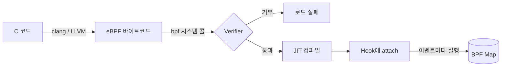
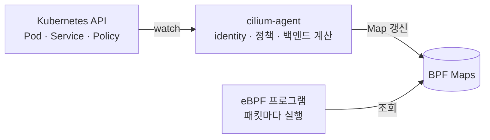
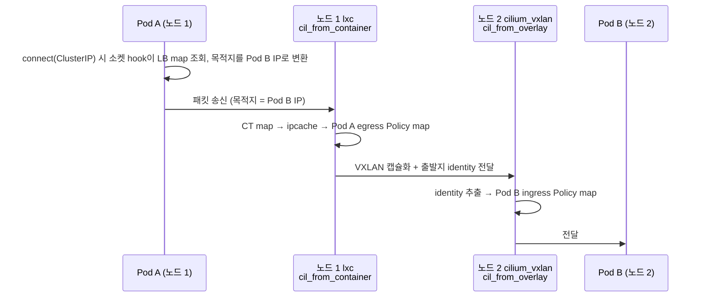
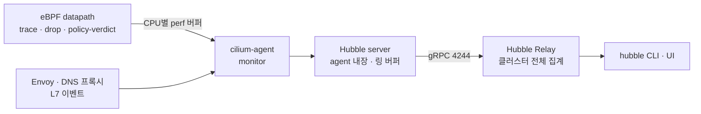

# Week 7. eBPF Deep Dive & Hubble

> eBPF 프로그램이 커널에서 실행되는 과정 → Cilium이 BPF Map으로 상태를 관리하며 패킷을 처리하는 방식 → 그 과정의 이벤트가 Hubble Flow가 되어 문제 추적에 쓰이기까지를 하나의 흐름으로 연결

5주차가 Cilium에 **무엇이 있는지**를 봤다면, 7주차는 그것이 **커널 안에서 어떻게 동작하고, 어떻게 들여다보는지**를 본다.
기준 버전은 Cilium 1.20(공식 문서 stable 1.20.2)이다.

---

## 1. eBPF 프로그램이 커널에서 실행되기까지

### 1.1 전체 흐름



| 단계 | 하는 일 | 짚을 점 |
| --- | --- | --- |
| 작성·컴파일 | 제한된 C 코드를 clang/LLVM으로 eBPF 바이트코드로 변환 | 커널 모듈이 아니라 바이트코드 |
| 로드 | 로더(libbpf, cilium/ebpf 등)가 `bpf()` 시스템 콜로 커널에 전달 | root 또는 `CAP_BPF` 권한 필요 |
| 검증 | Verifier가 가능한 모든 실행 경로를 따라가며 안전한지 확인 | 통과하지 못하면 로드 자체가 거부됨 |
| JIT | 바이트코드를 CPU 네이티브 명령어로 변환 | 커널에 직접 컴파일된 코드 수준의 속도 |
| Attach | 지정한 hook에 연결 | 이후 해당 이벤트가 생길 때마다 실행 |

Cilium에서는 cilium-agent가 로더 역할을 맡아, 엔드포인트 ID 같은 노드·엔드포인트별 설정값을 채워 프로그램을 로드한다.

### 1.2 Verifier — 안전성을 로드 시점에 증명

- **반드시 끝나야 한다.** 무한 루프는 불가하고, 종료 조건이 증명되는 bounded loop만 허용된다(커널 5.3+).
- **메모리 접근이 안전해야 한다.** 초기화하지 않은 변수나 범위를 벗어난 접근은 거부된다. 패킷 데이터를 읽으려면 먼저 길이 검사 코드가 있어야 통과한다.
- **아무 커널 함수나 호출할 수 없다.** 커널이 제공하는 helper 함수만 쓸 수 있다.
- **크기·복잡도 상한이 있다.** 검증 과정에서 처리할 수 있는 명령어는 약 100만 개, 스택은 512바이트다.

**짚고 넘어갈 점:** Verifier는 프로그램이 커널을 망가뜨리지 않는지 보는 **안전성(safety)** 도구이지, 프로그램이 무슨 일을 하는지 판단하는 **보안(security)** 도구가 아니다. 그래서 eBPF를 로드할 수 있는 권한 관리가 별도로 중요하다. 또 Cilium처럼 로직이 큰 datapath는 복잡도 상한 등을 이유로 tail call(다른 eBPF 프로그램으로 실행을 넘기는 방식)로 쪼개서 구성한다.

### 1.3 Hook — 어디에 붙이느냐가 역할을 결정한다

| Hook | 실행 시점 | Cilium에서의 용도 |
| --- | --- | --- |
| XDP | NIC 드라이버 단계, 네트워크 스택 처리 전(가장 이른 지점) | prefilter(CIDR 기반 차단), NodePort 가속 |
| TC ingress/egress | 스택의 초기 처리 이후, L3 이전 | 엔드포인트 정책, conntrack, Service 변환, 리다이렉트. **datapath의 중심** |
| cgroup 소켓 hook | `connect()` 같은 소켓 시스템 콜 시점 | socket LB. ClusterIP → 백엔드 변환을 연결 시점에 한 번 |
| socket ops / send·recv | TCP 상태 변화, 메시지 송신 시점 | 같은 노드 소켓 간 전달 가속(socket layer enforcement) |

**짚고 넘어갈 점:** Pod에서 **나가는** 트래픽은 호스트 쪽 veth(`lxc*`)의 **TC ingress**에서 처리된다. 호스트 입장에서는 들어오는 패킷이기 때문이다. 그래서 이 프로그램 이름이 `cil_from_container`다.

> Cilium 1.20에는 커널이 지원하면 veth 대신 netkit 디바이스를 쓰고, 아니면 veth로 동작하는 `bpf.datapathMode=auto` 옵션이 추가됐다. netkit은 프로그램이 붙는 위치가 다르므로 이 문서는 veth 기준으로 설명한다.

---

## 2. BPF Map과 Cilium Datapath

### 2.1 Map — 프로그램은 상태가 없고, 상태는 Map에 있다

eBPF 프로그램은 이벤트마다 실행되고 끝나므로 실행과 실행 사이에 상태를 들고 있을 수 없다. 대신 커널 안의 key-value 저장소인 **BPF Map**에 상태를 둔다. Map은 eBPF 프로그램과 사용자 공간 프로그램 양쪽에서 읽고 쓸 수 있고, Hash·Array·LRU Hash·LPM Trie(CIDR 최장 일치 조회)·이벤트 전달용 버퍼 등 종류가 다양하다.

3주차에서 CNI 플러그인이 실행 파일이라 상태는 별도 에이전트가 들고 있던 것과 같은 구조다. 이번에는 그 상태가 커널 안의 Map에 있다.



- **cilium-agent(컨트롤 플레인)**: Kubernetes 리소스를 감시하며 identity, 정책, Service 백엔드를 계산해 Map에 쓴다.
- **eBPF 프로그램(데이터 플레인)**: 패킷마다 Map을 **조회만** 하고 판단한다.

규칙을 위에서부터 차례로 비교하는 iptables와 달리 해시 조회로 끝나기 때문에, Service나 정책이 늘어도 패킷당 비용이 크게 늘지 않는다. Service나 정책이 바뀌어도 대부분은 프로그램을 다시 올리는 게 아니라 Map 항목만 갱신된다.

### 2.2 Cilium의 주요 Map

| Map | Key → Value (개념) | 역할 | 기본 상한 |
| --- | --- | --- | --- |
| ipcache | IP/CIDR → identity (+ 원격이면 해당 노드 IP) | "이 IP는 누구인가". 정책 판단과 터널 목적지의 출발점 | 512k |
| Endpoints | 로컬 Pod IP → 엔드포인트 정보 | 같은 노드 Pod로 바로 넘길지 판단 | 64k |
| Policy | (identity, 포트, 프로토콜, 방향) → 허용/거부 | **엔드포인트마다 하나씩** 존재 | 엔드포인트당 16k |
| LB | Service 주소 → 백엔드 목록, 백엔드 ID → Pod IP:포트, 역변환 정보 | kube-proxy replacement의 실체 | 서비스·백엔드 각 64k |
| Conntrack | 연결 5-tuple → 연결 상태 | 응답 패킷 식별, LB·NAT 역변환 | TCP 512k / UDP 등 256k |
| NAT | 변환 전후 주소·포트 | 클러스터 밖으로 나갈 때 SNAT | 512k |

기본 상한은 Cilium 1.20 문서 기준이며, 동적 크기 설정을 쓰면 달라진다.

### 2.3 Map을 따라가는 패킷 — Pod A → Service → Pod B (다른 노드, 터널 모드)



1. **socket LB**: Pod A가 ClusterIP로 `connect()`하면 소켓 hook이 **LB map**을 조회해 목적지를 백엔드(Pod B) IP로 바꾼다. 패킷에는 처음부터 Pod B IP가 찍힌다.
2. **송신 노드 `cil_from_container`**: **CT map**으로 새 연결인지 보고, **ipcache**로 목적지의 identity와 소속 노드를 찾고, Pod A의 egress **Policy map**을 확인한다.
3. **전달**: 목적지가 같은 노드면 **Endpoints map**으로 찾아 바로 넘기고, 다른 노드면 VXLAN으로 캡슐화하면서 **출발지 identity를 터널 헤더에 실어** 보낸다.
4. **수신 노드 `cil_from_overlay`**: 헤더에서 출발지 identity를 꺼낸다. 수신 노드에서 identity 조회를 한 번 줄이기 위한 최적화다.
5. Pod B의 ingress **Policy map**을 확인하고 허용이면 Pod B로 전달한다.
6. **응답 패킷**은 CT map에서 기존 연결의 응답으로 식별되어 반대 방향으로 돌아간다.

native routing 모드는 터널 헤더가 없으므로, 수신 노드가 출발지 IP로 ipcache를 조회해 identity를 알아낸다.

**짚고 넘어갈 점**
- **Map에는 상한이 있다.** 넘치면 삽입이 실패한다. CT·NAT map이 차면 새 연결이 드롭되고, LB map이 차면 Service 변경이 반영되지 않을 수 있다. `--bpf-map-dynamic-size-ratio`로 노드 메모리에 비례해 크기를 정할 수 있다.
- **socket LB를 쓰면 패킷에 ClusterIP가 나타나지 않는다.** Pod 네트워크에서 tcpdump로 ClusterIP를 찾으면 안 보이는 게 정상이다.
- **Map은 노드마다 따로 있다.** 특정 Pod의 문제를 볼 때는 그 Pod가 있는 노드의 cilium Pod에서 조회해야 한다.

---

## 3. eBPF 이벤트 → Hubble Flow

### 3.1 이벤트가 Flow가 되기까지



- datapath 프로그램은 처리 도중 **trace**(관측 지점 통과), **drop**(드롭과 원인), **policy-verdict**(정책 판단 결과) 이벤트를 CPU별 perf 이벤트 버퍼로 내보낸다. L7 이벤트는 Envoy와 DNS 프록시가 만든다.
- **Hubble server는 cilium-agent 안에 내장**되어 있다. 이벤트를 파싱하고 agent가 이미 아는 정보로 **Pod 이름·네임스페이스·레이블·identity·Service 이름**을 붙여 Flow로 만든다. IP와 숫자뿐인 이벤트를 사람이 읽을 수 있게 만드는 것이 Hubble의 핵심이다.
- Flow는 사용자 공간 **링 버퍼**에 저장된다. 기본 용량은 노드당 4095개이고, 가득 차면 오래된 것부터 덮어쓴다. **지나간 Flow는 금방 사라진다**는 뜻이므로, 오래 보관하려면 Hubble 메트릭이나 exporter가 따로 필요하다.
- **Hubble Relay**는 각 노드의 Hubble server(기본 포트 4244, mTLS)에 연결해 클러스터 전체 Flow를 하나의 API로 제공한다.

### 3.2 Flow에서 볼 것

| 필드 | 의미 | 포인트 |
| --- | --- | --- |
| source / destination | Pod, 네임스페이스, 레이블, identity | `reserved:world`면 클러스터 밖, `reserved:host`면 노드 자체 |
| verdict | `FORWARDED` / `DROPPED` / `AUDIT` 등 | `AUDIT`은 감사 모드에서 "적용했다면 막혔을" 트래픽 |
| drop reason | 드롭 원인 | 가장 흔한 것은 `POLICY_DENIED` |
| 이벤트 유형 / 관측 지점 | `to-endpoint`, `to-stack`, `to-overlay`, `policy-verdict`, L7 등 | 패킷이 어디까지 갔는지 |
| traffic direction | INGRESS / EGRESS | 어느 쪽 정책에서 막혔는지 |
| L7 | HTTP 메서드·경로·상태 코드, DNS 질의 | L7 정책이 걸린 트래픽에만 채워짐 |

`hubble observe -o compact` 출력 예시(Pod 이름·ID는 임의):

```text
# 정책 적용 전
default/client-6d9f:52341 (ID:12345) -> default/server-7c8b:8080 (ID:67890) to-endpoint FORWARDED (TCP Flags: SYN)

# server에 "app=client만 허용" 정책 적용 후, 다른 Pod에서 접속
default/other-5b2a:40112 (ID:23456) -> default/server-7c8b:8080 (ID:67890) policy-verdict:none INGRESS DENIED (TCP Flags: SYN)
default/other-5b2a:40112 (ID:23456) <> default/server-7c8b:8080 (ID:67890) Policy denied DROPPED (TCP Flags: SYN)
```

### 3.3 Hubble로 NetworkPolicy 만들고 검증하기

1. **관찰**: 정책 없이 `hubble observe --namespace <ns>`로 실제 통신 관계(누가, 누구에게, 어떤 포트로)를 확인한다.
2. **초안**: 관찰한 Flow를 기준으로 허용 정책을 쓴다. egress를 제한한다면 kube-dns 53번 허용을 빠뜨리지 않는다.
3. **감사 모드 적용**: 전역은 Helm 값 `policyAuditMode: true`, 엔드포인트별은 `cilium-dbg endpoint config <EP_ID> PolicyAuditMode=Enabled`. 막지 않고 `AUDIT`으로 기록만 한다.
4. **빠진 규칙 찾기**: `hubble observe --verdict AUDIT`에 나온 트래픽을 허용할지, 의도적으로 막을지 정한다.
5. **적용 후 감시**: 감사 모드를 끄고 `hubble observe --verdict DROPPED`로 예상하지 못한 차단이 없는지 본다.

**짚고 넘어갈 점**
- 엔드포인트를 선택하는 정책이 하나라도 생기면 그 방향은 **기본 거부**로 바뀐다. egress 정책에서 DNS 허용을 빠뜨려 이름 해석이 안 되는 장애가 대표적이며, Hubble에서는 kube-dns로 가는 53번 트래픽의 `DROPPED`로 보인다.
- 감사 모드는 검증용이지 보호 수단이 아니다.
- L7 가시성은 L7 규칙이 들어간 CiliumNetworkPolicy가 있어야 생긴다. 해당 트래픽은 Envoy를 거치고, L7 규칙은 보기만 하는 게 아니라 실제로 트래픽을 제한한다. HTTP 헤더·쿼리 같은 민감 정보는 기본적으로 가려지지 않으므로 redact 옵션을 고려한다.

### 3.4 통신 문제를 Hubble로 좁혀 가기

| 증상 | 먼저 볼 것 | 해석 |
| --- | --- | --- |
| 특정 Pod로 연결이 안 됨 | `hubble observe --to-pod <ns>/<pod> --verdict DROPPED` | `POLICY_DENIED`면 정책 문제. direction으로 ingress/egress를 구분하고 `cilium-dbg bpf policy get <EP_ID>`로 실제 Map 확인 |
| 이름 해석 실패 | `hubble observe --pod <ns>/<pod> --port 53` | DNS 요청이 `DROPPED`면 egress 정책 누락 |
| Service로만 안 됨 | `cilium-dbg service list` | 백엔드가 비어 있으면 EndpointSlice·readiness 문제 |
| Flow가 아예 안 보임 | Hubble 동작 확인 후, 패킷이 datapath까지 오는지 | 노드 간 경로, 방화벽(VXLAN 8472/UDP), MTU 쪽 → 8주차 범위 |
| 정책과 무관한 드롭 | drop reason | 예: CT map 삽입 실패 → Map 상한 점검 |

---

## 4. Hands-on (선택)

```bash
# Map은 노드별 — 대상 Pod가 있는 노드의 cilium Pod를 고른다
kubectl -n kube-system get pod -l k8s-app=cilium -o wide
CILIUM=<그 노드의 cilium Pod 이름>

# eBPF 프로그램·Map (cilium 컨테이너에 bpftool 포함)
kubectl -n kube-system exec $CILIUM -- bpftool net show     # 인터페이스별 XDP/TC 프로그램
kubectl -n kube-system exec $CILIUM -- bpftool prog show    # jited 크기가 보이면 JIT된 것
kubectl -n kube-system exec $CILIUM -- bpftool map show

# Cilium Map
kubectl -n kube-system exec $CILIUM -- cilium-dbg endpoint list
kubectl -n kube-system exec $CILIUM -- cilium-dbg bpf ipcache list
kubectl -n kube-system exec $CILIUM -- cilium-dbg bpf policy get <EP_ID>
kubectl -n kube-system exec $CILIUM -- cilium-dbg bpf lb list
kubectl -n kube-system exec $CILIUM -- cilium-dbg bpf ct list global

# Hubble
cilium hubble port-forward &
hubble observe --namespace default --last 20
hubble observe --verdict DROPPED -f
```

`bpftool net show` 결과를 보면 1~2장에서 본 프로그램이 실제 인터페이스에 붙어 있는 것을 확인할 수 있다(일부 발췌, 인터페이스 이름은 예시).

```text
eth0(2)              tcx/ingress cil_from_netdev      # 노드 NIC로 들어오는 트래픽
cilium_host(5)       tcx/ingress cil_to_host
cilium_vxlan(6)      tcx/ingress cil_from_overlay     # 터널로 들어온 Pod 트래픽
lxc7d9779c20d88(16)  tcx/ingress cil_from_container   # Pod에서 나가는 트래픽
```

커널 6.6 이상이면 Cilium은 기본적으로 tcx 방식으로 프로그램을 붙여 위처럼 `tcx/ingress`로 보이고, 지원하지 않는 커널에서는 기존 tc 방식으로 붙는다. 어느 쪽인지는 `cilium-dbg status`의 `Attach Mode`로 확인할 수 있다.

**FORWARDED / DROPPED 비교**: 아래 정책 적용 전후로 `app=client` Pod와 다른 Pod에서 server에 접속해 보고, Hubble Flow와 `cilium-dbg bpf policy get <server의 EP_ID>` 결과가 어떻게 바뀌는지 같이 본다.

```yaml
apiVersion: cilium.io/v2
kind: CiliumNetworkPolicy
metadata:
  name: server-allow-client
spec:
  endpointSelector:
    matchLabels:
      app: server
  ingress:
  - fromEndpoints:
    - matchLabels:
        app: client
    toPorts:
    - ports:
      - port: "8080"
        protocol: TCP
```

---

## 5. 질문

1. Verifier는 안전성만 보장하고 프로그램의 의도는 판단하지 않는다. 그렇다면 노드에서 eBPF 프로그램을 로드할 수 있는 권한은 어떻게 통제해야 할까?
2. native routing에서는 수신 노드가 출발지 IP로 ipcache를 조회해 identity를 알아낸다. Pod가 삭제되고 같은 IP가 다른 Pod에 재할당되는 순간 ipcache 갱신이 늦으면 어떤 일이 생길 수 있을까?
3. Hubble 링 버퍼는 노드당 기본 4095개 Flow만 보관한다. 트래픽이 많은 노드에서 "어젯밤 끊긴 연결"을 추적하려면 무엇을 미리 준비해 둬야 할까?

---

## 6. 정리

- eBPF 프로그램은 바이트코드로 로드되어 **Verifier가 안전성을 증명**하고, **JIT으로 네이티브 코드**가 된 뒤, **hook**에 붙어 이벤트마다 실행된다.
- 프로그램 자체는 상태가 없다. **cilium-agent가 계산한 상태를 Map에 넣어 두면**, 프로그램은 패킷마다 ipcache로 "누구인가", Policy map으로 "허용되는가", LB map으로 "어디로 보낼까"를 조회해 판단한다.
- datapath가 내보낸 trace·drop·policy-verdict 이벤트에 agent가 Pod·identity 정보를 붙인 것이 **Hubble Flow**다.
- 문제 추적은 verdict와 drop reason으로 **어디서, 왜** 막혔는지 좁힌 뒤, 해당 노드의 실제 Map 상태로 확인하는 순서로 한다.

---

## 참고 자료

- [eBPF.io — What is eBPF?](https://ebpf.io/what-is-ebpf/)
- [Linux Kernel — BPF Design Q&A](https://www.kernel.org/doc/html/latest/bpf/bpf_design_QA.html)
- [eBPF Docs — Loops](https://docs.ebpf.io/linux/concepts/loops/)
- [Cilium — eBPF Datapath Introduction](https://docs.cilium.io/en/stable/network/ebpf/intro/)
- [Cilium — Life of a Packet](https://docs.cilium.io/en/stable/network/ebpf/lifeofapacket/)
- [Cilium — eBPF Maps](https://docs.cilium.io/en/stable/network/ebpf/maps/)
- [Cilium — Routing (Encapsulation / Native-Routing)](https://docs.cilium.io/en/stable/network/concepts/routing/)
- [Cilium — Hubble internals](https://docs.cilium.io/en/stable/internals/hubble/)
- [Cilium — Layer 7 Protocol Visibility](https://docs.cilium.io/en/stable/observability/visibility/)
- [Cilium — Command Cheatsheet](https://docs.cilium.io/en/stable/cheatsheet/)
- [CNCF Blog — Safely managing Cilium network policies (audit mode)](https://www.cncf.io/blog/2025/11/06/safely-managing-cilium-network-policies-in-kubernetes-testing-and-simulation-techniques/)
- [Isovalent — Cilium 1.20 release](https://isovalent.com/blog/post/cilium-1-20/)
- [eCHO Episode 51 — Life of a Packet with Cilium (영상)](https://www.youtube.com/watch?v=0BKU6avwS98)
