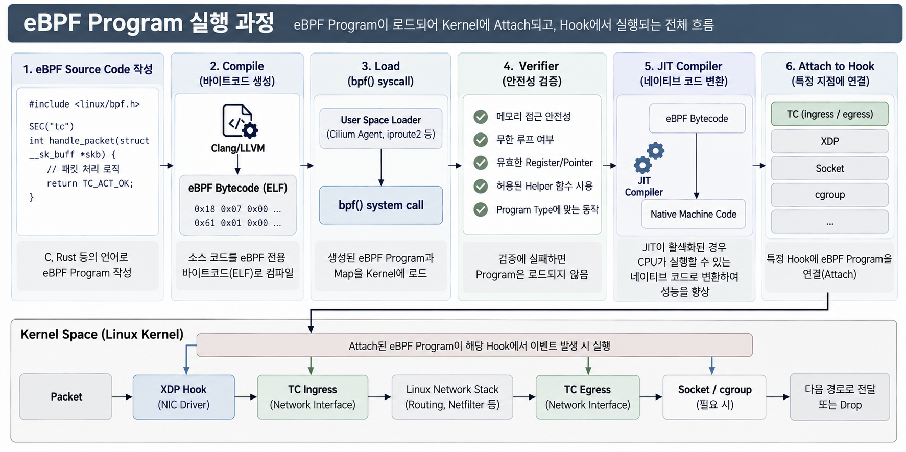
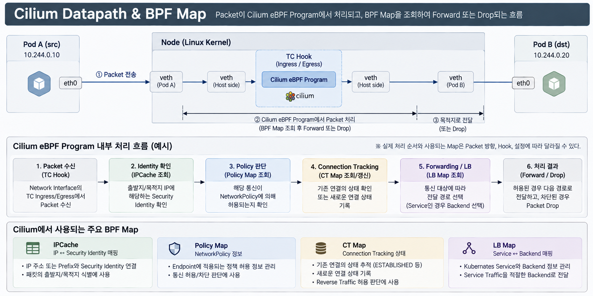
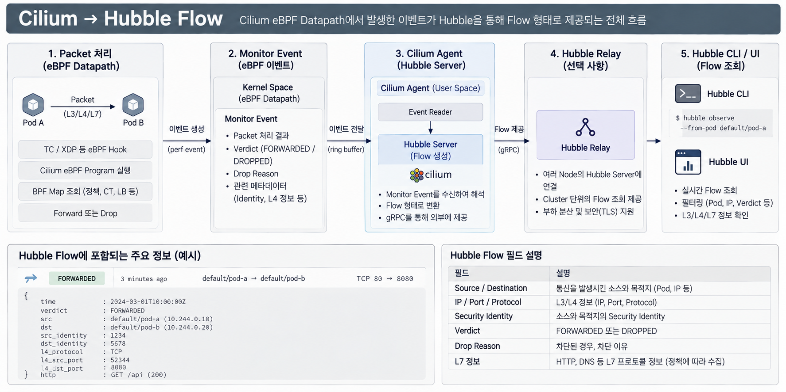

# Week 7. eBPF Deep Dive & Hubble

## 1. 이번 주 학습 목표

Week 5에서는 Cilium이 eBPF를 활용하여 Kubernetes Network를 처리하고, Hubble을 통해 Traffic을 관측하는 구조를 살펴봤다.

이번 주에는 **eBPF가 Kernel에서 실행되는 원리와 Cilium이 BPF Map을 활용해 Packet을 처리하고 관측하는 과정**을 알아본다.

```text
Packet 발생
    ↓
eBPF Hook
    ↓
eBPF Program 실행
    ↓
BPF Map 조회
    ↓
Forward / Drop
    ↓
Datapath Event
    ↓
Hubble Flow
```

---

## 2. eBPF Program은 Kernel에서 어떻게 실행되는가

**eBPF(extended Berkeley Packet Filter)** 는 Kernel의 특정 지점에서 사용자 정의 Program을 실행할 수 있도록 하는 기술이다.

eBPF Program은 Cilium 같은 솔루션 개발자가 미리 작성할 수도 있고, 사용자가 네트워크 제어, 보안, 성능 관측 등의 목적으로 직접 개발할 수도 있다.

예를 들어 Cilium을 설치하면 Cilium Agent가 필요한 eBPF Program을 Kernel에 로드하고 관리하므로, 사용자가 직접 eBPF 코드를 작성할 필요는 없다.

### 2.1 Program과 Verifier

eBPF Program은 보통 C 등의 언어로 작성한 뒤 eBPF Bytecode로 컴파일한다.

이후 User Space의 Loader가 `bpf()` System Call을 이용해 Kernel에 Program을 로드한다.

Kernel은 실행 전에 **Verifier**를 통해 Program의 안전성을 검사한다.

대표적인 검증 항목은 다음과 같다.

- 메모리 접근의 안전성
- Register와 Pointer의 유효성
- Program이 종료할 수 있는지
- Program Type에 맞는 Helper 사용 여부

**Helper Function**은 eBPF Program이 Kernel에서 제공하는 특정 기능을 사용하기 위한 함수다.

예를 들어 `bpf_map_lookup_elem()`은 BPF Map에서 데이터를 조회하는 Helper다. Program Type에 따라 사용할 수 있는 Helper가 다르며, 허용되지 않은 Helper를 호출하면 검증에 실패할 수 있다.

검증에 실패한 Program은 로드되지 않는다.

### 2.2 JIT Compiler

Verifier를 통과한 eBPF Program은 Kernel의 eBPF 실행 환경에서 동작한다.

실행 방식에는 Interpreter와 JIT Compiler 방식이 있다.

| 구분 | Interpreter | JIT Compiler |
|---|---|---|
| 실행 방식 | Bytecode를 실행 시 해석 | Bytecode를 Native Machine Code로 변환 |
| 특징 | 명령어 해석 비용 발생 | 반복적인 해석 비용 감소 |
| 성능 | 상대적으로 느릴 수 있음 | 반복 실행에 유리 |

**JIT(Just-In-Time) Compiler**는 eBPF Bytecode를 CPU가 직접 실행할 수 있는 Native Machine Code로 변환한다.

Interpreter는 Bytecode의 명령어를 실행할 때마다 해석해야 하지만, JIT는 미리 변환한 Machine Code를 실행하므로 반복적인 해석 비용을 줄일 수 있다.

특히 Packet마다 실행되는 eBPF Program에서는 이러한 차이가 성능에 영향을 줄 수 있다.

### 2.3 Hook과 Attach

**Hook**은 Kernel에서 eBPF Program을 실행할 수 있는 지점을 의미한다.

TC, XDP처럼 Network Event에 반응하는 eBPF Program은 로드된 후 해당 Hook에 Attach된다.

이후 해당 Hook에서 이벤트가 발생하면 Kernel이 eBPF Program을 실행한다.



eBPF Program은 일반적인 Process처럼 독립적으로 계속 실행되기보다는, 해당 Hook에서 이벤트가 발생할 때 실행된다.

하나의 Hook에 여러 eBPF Program을 연결하는 것도 가능하지만, 지원 여부와 실행 순서는 Hook 및 연결 방식에 따라 달라진다.

또한 eBPF Program과 Map은 Kernel Memory를 사용하며, Program이 복잡하거나 실행 횟수가 많으면 CPU 사용량에도 영향을 줄 수 있다.

> **eBPF Program은 Bytecode로 컴파일되고, Kernel의 Verifier를 통과한 뒤 필요한 Hook에 연결되어 이벤트 발생 시 실행된다.**

---

## 3. eBPF Hook과 Packet 처리 위치

eBPF는 어디에 Attach하느냐에 따라 Packet을 관찰하거나 처리하는 시점이 달라진다.

| Hook | 위치 | 주요 활용 |
|---|---|---|
| XDP | NIC Driver의 초기 수신 경로 | 빠른 Packet Drop / Redirect |
| TC | Network Interface의 Ingress / Egress | Policy, Forwarding, Redirect |
| Socket / cgroup | Socket 관련 동작 | Socket 기반 LB, 연결 제어 |

### 3.1 XDP

**XDP(eXpress Data Path)** 는 수신 Packet을 Network Stack의 초기 단계에서 처리하는 기술이다.

일반적인 Native XDP는 NIC Driver가 Packet을 수신한 직후, Linux Kernel이 Packet을 관리하는 SKB(Socket Buffer)를 생성하기 전에 실행된다.

```text
NIC Packet 수신
       ↓
NIC Driver
       ↓
XDP Program 실행
       ↓
SKB 생성
       ↓
Linux Network Stack
```

이를 통해 불필요한 Network Stack 처리를 줄이고 Packet을 빠르게 Drop하거나 Redirect할 수 있다.

단, Generic XDP처럼 SKB를 사용하는 실행 방식도 존재한다.

### 3.2 TC

**TC(Traffic Control)** 는 Linux Network Interface의 Traffic을 제어하는 기능이다.

TC Hook은 Network Interface의 Ingress 또는 Egress 경로에서 실행된다.

Cilium은 TC Hook을 활용하여 Endpoint의 Packet에 NetworkPolicy, Forwarding 등의 처리를 수행할 수 있다.

예를 들어 Pod에서 전송한 Packet은 Host 측 veth의 TC Ingress Hook에서 처리될 수 있다.

### 3.3 Socket / cgroup

Socket 관련 Hook은 Socket 연결과 주소 처리 단계 등에 개입할 수 있다.

Cilium은 이러한 Hook을 이용해 Socket 기반 Service Load Balancing 등을 수행할 수 있다.

**따라서 Cilium의 모든 기능이 하나의 Hook에서 실행되는 것은 아니다.**

---

## 4. BPF Map과 Cilium Datapath

### 4.1 BPF Map이란?

BPF Map은 eBPF Program이 상태와 설정 정보를 저장하거나 조회할 수 있는 Kernel 자료구조다.

eBPF Program과 User Space Program은 적절한 권한을 통해 Map을 공유할 수 있다.

예를 들어 Cilium Agent는 NetworkPolicy와 Endpoint 정보를 관리하고, Datapath의 eBPF Program은 관련 Map을 조회해 Packet 처리에 활용한다.

```text
Cilium Agent (User Space)
       │
       │ Map 조회 / 갱신
       ▼
    BPF Map
       ▲
       │ Map 조회 / 갱신
       │
eBPF Program (Kernel)
```

Map의 종류에 따라 Cilium Agent 또는 eBPF Program이 데이터를 조회하거나 갱신한다.

### 4.2 Cilium에서 사용하는 주요 BPF Map

| Map | 주요 역할 |
|---|---|
| IPCache | IP 주소 또는 Prefix와 Security Identity 등의 정보 연결 |
| Policy Map | Endpoint에 적용되는 정책 허용 정보 관리 |
| CT Map | Connection Tracking 상태 관리 |
| LB Map | Service와 Backend 정보 관리 |

**① IPCache**

Packet의 출발지나 목적지에 해당하는 Security Identity 등을 확인하는 데 사용된다.

- **Prefix**: `10.244.1.0/24`처럼 IP 주소의 Network 대역을 표현한 것
- **Security Identity**: Cilium이 Endpoint의 Security Label을 기반으로 부여하는 식별자

Cilium은 이러한 Identity를 이용하여 IP 주소만이 아닌 Endpoint의 보안 속성을 기준으로 NetworkPolicy를 적용할 수 있다.

**② Policy Map**

Endpoint에 적용되는 정책 허용 정보를 관리한다.

eBPF Program은 Policy Map과 연결 상태 등을 활용하여 해당 통신의 허용 여부를 판단한다.

**③ CT Map**

CT(Connection Tracking)는 Network Connection의 상태를 추적하는 기능이다.

출발지·목적지 IP, Port, Protocol 등의 정보를 이용해 새로운 연결과 기존 연결의 Packet을 구분하고 상태를 관리한다.

**④ LB Map**

Kubernetes Service와 Backend 정보를 관리한다.

Service Traffic을 적절한 Backend로 전달하기 위한 Load Balancing 과정에서 활용된다.

실제 조회되는 Map과 처리 순서는 Packet의 방향, Hook, Service 사용 여부 등에 따라 달라진다.

---

## 5. Packet 하나를 따라가며 Cilium Datapath 이해하기

Pod A에서 Pod B로 Packet을 전송한다고 가정하자.

일반적인 veth 기반 구성에서는 Pod가 전송한 Packet이 Host 측 veth의 TC Hook에 진입할 수 있다.

Cilium의 eBPF Program은 이후 필요한 BPF Map을 조회하면서 Packet을 처리한다.



각 단계의 핵심은 다음과 같다.

### ① Identity 확인

Cilium은 Endpoint에 부여된 Security Identity를 활용하여 통신 대상을 식별한다.

필요한 경우 IPCache를 조회해 IP 주소에 연결된 Identity 정보를 확인한다.

### ② Policy 판단

Policy Map과 연결 상태 등을 바탕으로 해당 통신이 허용되는지 판단한다.

정책상 허용되지 않는 Traffic은 Drop될 수 있다.

### ③ Connection Tracking

CT Map을 통해 기존 Connection의 상태를 확인하거나 새로운 연결 상태를 기록한다.

### ④ Forwarding / Load Balancing

통신 대상에 따라 적절한 전달 경로를 선택한다.

Kubernetes Service로 향하는 Traffic이라면 구성된 Hook과 Datapath에 따라 LB Map을 활용해 Backend를 선택할 수 있다.

이후 Packet은 적절한 경로로 전달되거나 Drop된다.

> 이 흐름은 개념적인 예시다. 실제 Cilium Datapath는 Hook, 설정, Packet 방향에 따라 처리 단계와 순서가 달라진다.

---

## 6. eBPF Event와 Hubble

Kernel의 TC/XDP 등에서 실행되는 Cilium eBPF Program은 Packet 처리 과정에서 **Monitor Event**를 생성할 수 있다.

예를 들어 NetworkPolicy에 의해 Packet을 Drop하면, 해당 처리 결과와 Drop Reason 등의 정보를 Event로 전달할 수 있다.

이벤트는 Kernel의 이벤트 전달 경로를 통해 Cilium Agent에 수집되며, Hubble Server는 이를 해석해 Flow 정보로 제공한다.

Hubble Server는 Cilium Agent 내부에서 동작하고, Hubble Relay는 여러 Node의 Hubble Server에 연결하여 Cluster 단위의 Flow 조회를 지원한다.



단, 모든 Packet에 대해 반드시 Event가 생성되는 것은 아니며, 관측 범위와 설정에 따라 수집되는 정보가 달라질 수 있다.

### 6.1 Hubble Flow

Hubble Flow에는 상황에 따라 다음과 같은 정보가 포함될 수 있다.

- Source / Destination
- IP / Port / Protocol
- Security Identity
- Verdict
- Drop Reason
- L7 정보

### 6.2 FORWARDED / DROPPED

| Verdict | 의미 |
|---|---|
| FORWARDED | 관측 지점에서 Packet이 전달됨 |
| DROPPED | Packet이 차단되거나 폐기됨 |

예를 들어 NetworkPolicy에 의해 통신이 거부되었다면 Hubble에서 `DROPPED` Flow와 관련 Drop Reason을 확인할 수 있다.

반대로 `FORWARDED` Flow는 관측 지점에서 Packet이 전달되었음을 의미한다.

단, **FORWARDED가 최종 목적지까지의 정상 도착을 반드시 보장하지는 않는다.**

---

## 참고 자료

- eBPF 공식 문서  
  https://ebpf.io/what-is-ebpf/

- Linux Kernel BPF 문서  
  https://docs.kernel.org/bpf/

- Cilium eBPF Datapath  
  https://docs.cilium.io/en/stable/network/ebpf/

- Cilium BPF and XDP Reference Guide  
  https://docs.cilium.io/en/stable/reference-guides/bpf/

- Hubble Documentation  
  https://docs.cilium.io/en/stable/observability/hubble/

- Cilium CLI Reference  
  https://docs.cilium.io/en/stable/cmdref/