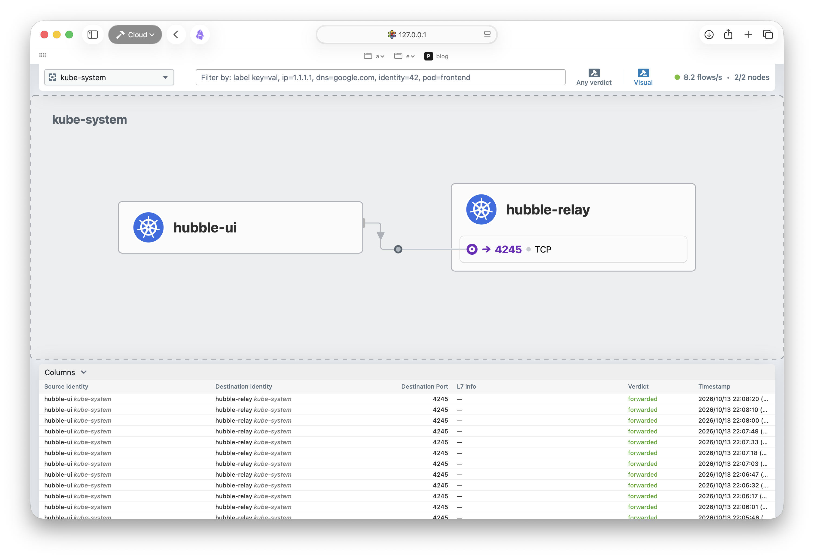
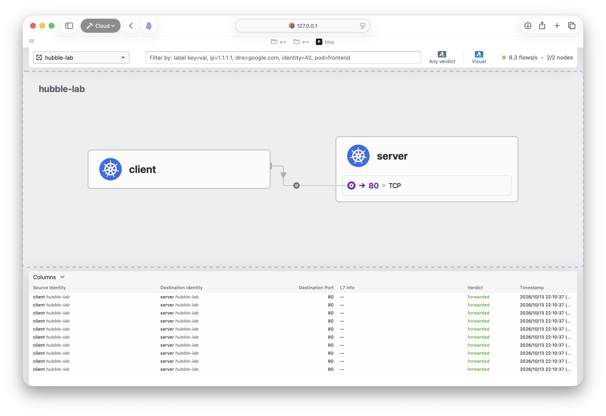
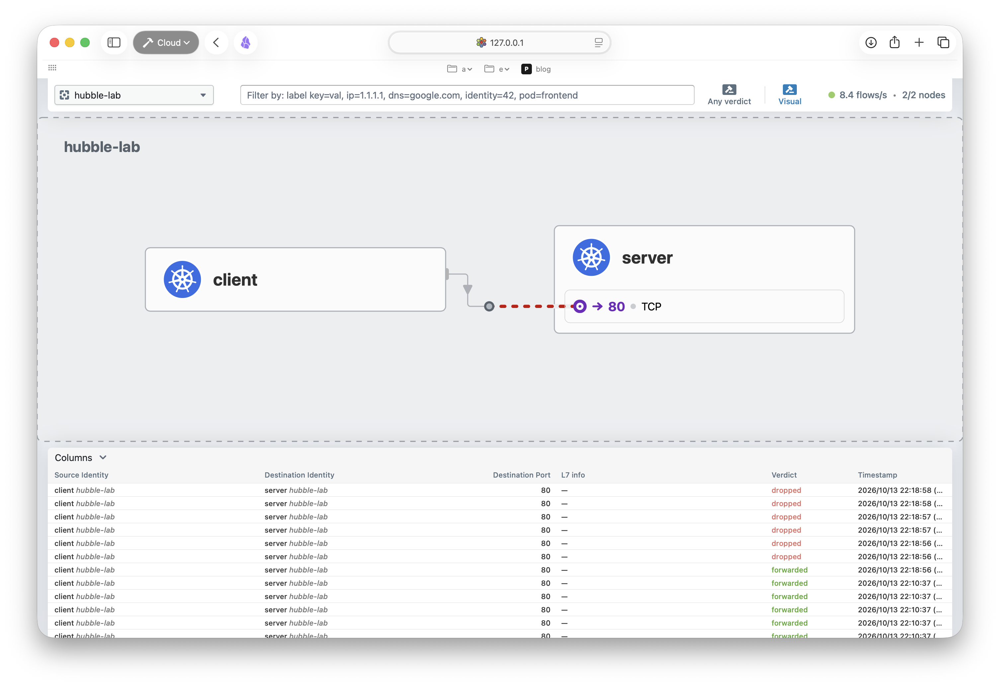
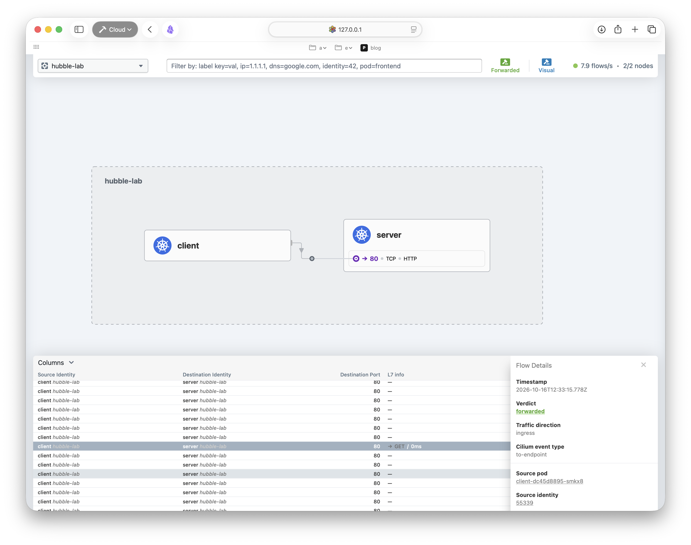
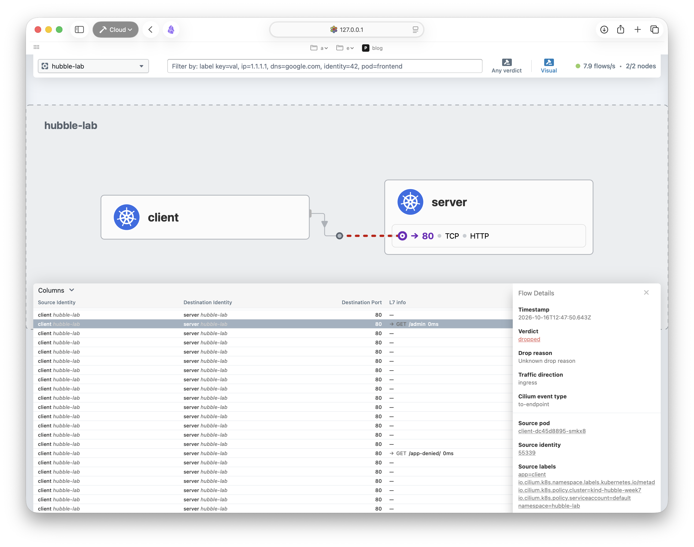
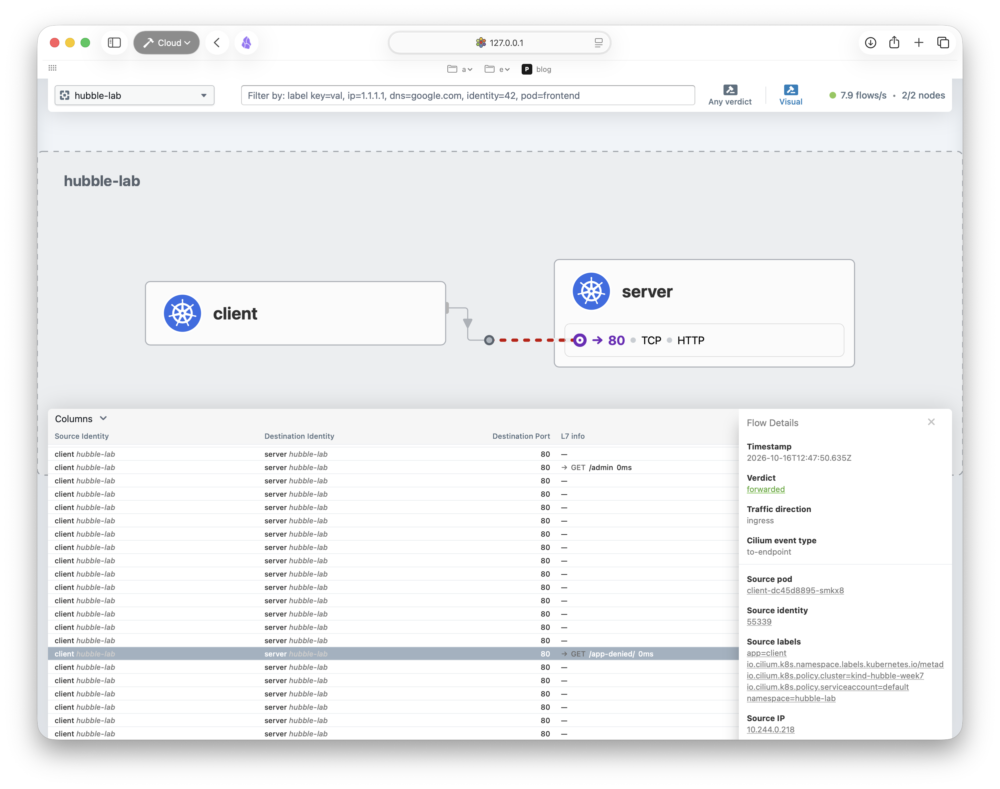

# W7. eBPF Deep Dive & Hubble

## 1. 주제 선정: Hubble로 통신 실패 추적하기

이번 주에는 Hubble을 중심으로 실제 통신 실패를 추적해봤습니다. Week5에서 남겨둔 질문 중 L7 정책 차단으로 생긴 403과 서버가 반환한 403을 어떻게 구분하는지 확인하는 데 집중했습니다.

## 2. eBPF, Cilium, Hubble의 실행 레이어

커널 공간과 사용자 공간은 같은 OS 안에서 메모리 접근과 실행 권한을 나눈 영역. 사용자 공간의 프로그램은 시스템 호출 등으로 커널 기능을 사용.

eBPF는 커널의 Hook에서 프로그램을 실행하는 기술. 로드할 때 Verifier가 안전성을 검사하고 JIT로 기계어 실행이 가능함. Cilium agent는 프로그램과 BPF Map의 상태를 관리해서 패킷 전달과 정책 판단에 사용함.

Hubble server는 사용자 공간에서 실행. Cilium agent 안에 포함돼 있으므로 관리 노드와 워커 각각의 agent에서 켜짐.

| 구성 | 위치와 역할 |
| --- | --- |
| Cilium eBPF 프로그램 | 커널에서 패킷을 처리하고 관측 이벤트를 발생시킴 |
| Cilium agent 안의 Hubble server | 자기 노드의 관측 기록을 gRPC로 제공함 |
| Hubble Relay | 여러 노드의 Hubble server에 연결해 조회 결과를 모아줌 |
| Hubble CLI와 UI | Relay나 노드 서버에 접속해 기록을 확인함 |

Relay는 여러 서버에 접속하는 기능을 독립 구성요소로 둔 것. 관리 노드에 Hubble server가 없어도 Pod 네트워크와 배치 조건이 갖춰지면 Relay를 둘 수 있음. 대신 그 노드의 관측 기록은 빠짐.

참고자료: [구성 요소](https://docs.cilium.io/en/stable/overview/component-overview/), [eBPF](https://ebpf.io/what-is-ebpf/)

## 3. 이벤트가 Flow로 보이는 과정

```text
eBPF Datapath의 관측 이벤트 → Cilium monitor → Hubble Flow
HTTP 프록시의 관측 기록    → Cilium monitor → Hubble Flow
                                              ↓
                              노드의 메모리 링 버퍼 → Relay → CLI / UI
```

Flow에는 주소, 포트, Pod 이름, namespace, Identity, 관측 노드도 들어감.

실제 JSON의 `event_type.type`은 trace 4, drop 1, policy verdict 5, HTTP L7 기록 129였음. 129는 AccessLog로, 프록시의 관측 기록임.

BPF Map은 패킷 처리에 필요한 상태를, Hubble의 사용자 공간 링 버퍼는 조회할 관측 기록을 보관함.

참고자료: [Hubble 내부 구조](https://docs.cilium.io/en/stable/internals/hubble/), [이벤트 유형 코드](https://github.com/cilium/cilium/blob/v1.20.2/pkg/monitor/api/types.go)

## 4. 실습 환경과 접속

| 항목 | 실제 구성 |
| --- | --- |
| 클러스터 | kind `hubble-week7`, 관리 노드 1개와 워커 1개 |
| 버전 | Kubernetes 1.35.8, Cilium과 Hubble CLI 1.20.2 |
| Pod 배치 | client는 관리 노드, Nginx server는 워커 |
| 요청 대상 | `server.hubble-lab.svc.cluster.local:80` |

두 kind 노드는 Docker Linux VM의 커널을 공유함. kind의 기본 CNI를 끈 상태에서는 둘 다 NotReady였고, Cilium 설치 후 Ready로 바뀜. kube-proxy는 유지한 구성임.

전용 kubeconfig로 작업하고, 원격 접속이 필요한 환경에서 실습하여 localhost 포트포워드를 SSH 터널로 연결함.

```text
로컬:4245  → SSH → 원격:4245  → kubectl port-forward → Relay
로컬:12000 → SSH → 원격:12000 → kubectl port-forward → UI
```



참고자료: [Hubble 접속](https://docs.cilium.io/en/stable/observability/hubble/setup/)

## 5. 정상 통신, ingress 차단, 복구

Service의 DNS 이름으로 요청해 HTTP 200을 확인함. 관리 노드의 `to-overlay FORWARDED`와 워커의 `to-endpoint FORWARDED`는 다른 노드로 보낼 때와 서버 Pod에 전달할 때의 기록임.



그다음 app=server인 Pod를 선택하고, ingress 허용 목록이 빈 NetworkPolicy를 적용함.

```yaml
spec:
  podSelector:
    matchLabels:
      app: server
  policyTypes:
    - Ingress
  ingress: []
```

정책이 endpoint에 반영된 뒤 같은 요청을 보냄. curl은 3초 뒤 종료 코드 28로 시간 초과가 남. 출력의 HTTP 000은 서버의 응답 코드가 아니라 HTTP 응답을 받지 못했다는 표시임.

| 관측 지점 | 실제 기록 |
| --- | --- |
| 관리 노드 | `to-overlay FORWARDED`, TCP SYN |
| 워커 | `policy-verdict:none INGRESS DENIED`, TCP SYN |
| 워커 | `Policy denied DROPPED`, TCP SYN |



FORWARDED는 해당 지점에서 다음 처리 대상으로 넘겼다는 뜻임. 목적지에서 버릴 수도 있음. SYN 재전송과 서로 다른 관측 이벤트 때문에 요청 한 번에 여러 줄이 기록됨.

app=client의 TCP 80을 허용하니 HTTP 200으로 복구되고 워커도 `INGRESS ALLOWED`로 바뀜.

참고자료: [Flow 판정 정의](https://docs.cilium.io/en/stable/_api/v1/flow/README/#verdict)

## 6. 같은 포트에서 HTTP 경로 구분

IP와 포트만으로 GET /와 GET /admin을 구분할 수 없어서 CiliumNetworkPolicy에 HTTP 규칙을 추가함. GET /만 허용한 규칙의 핵심은 아래와 같음.

```yaml
toPorts:
  - ports:
      - port: '80'
        protocol: TCP
    rules:
      http:
        - method: GET
          path: '/$'
```

기존 TCP 80 전체 허용 목록도 비움. 넓은 L4 허용을 함께 남기면 정책을 합칠 때 L7 제한이 효과를 내지 못하기 때문.

대상 통신은 사용자 공간의 Envoy 프록시로 보내 HTTP 메서드와 경로를 검사함. Envoy는 독립적인 오픈소스 프록시이고 Cilium이 L7 검사에 사용함.

| 요청 | curl 결과 | Hubble의 HTTP 요청 판정 |
| --- | --- | --- |
| GET / | HTTP 200 | FORWARDED |
| GET /admin | HTTP 403 | DROPPED |





L3/L4 차단에서는 SYN이 버려져 연결부터 실패했지만, L7에서는 연결 후 HTTP 요청을 거부해 403을 돌려줌. 요청은 DROPPED, 403 응답은 클라이언트에게 전달돼 FORWARDED로 기록됨.

참고자료: [L7 정책](https://docs.cilium.io/en/stable/security/policy/layer7/), [Envoy](https://www.envoyproxy.io/docs/envoy/latest/intro/what_is_envoy)

## 7. 서버의 403과 정책의 403 비교

Nginx에 index 파일이 없는 app-denied 디렉터리를 만들고 정책에서 GET을 허용함. Nginx가 목록 제공을 거부해서 403을 반환함.

실제 CLI 기록에서 Pod 주소를 생략한 4줄.

```text
http-request FORWARDED (HTTP/1.1 GET http://server.hubble-lab.svc.cluster.local/app-denied/)
http-response FORWARDED (HTTP/1.1 403 1ms (GET http://server.hubble-lab.svc.cluster.local/app-denied/))
http-request DROPPED (HTTP/1.1 GET http://server.hubble-lab.svc.cluster.local/admin)
http-response FORWARDED (HTTP/1.1 403 0ms (GET http://server.hubble-lab.svc.cluster.local/admin))
```



두 응답 모두 403이지만 /app-denied/ 요청은 FORWARDED, /admin 요청은 DROPPED. 앞쪽은 Nginx, 뒤쪽은 Envoy가 거부. Nginx 로그에도 GET /app-denied/ 403과 directory index 금지 오류가 남음.

최종 정책은 GET /와 /app-denied/를 허용. app-denied 디렉터리는 실행 중인 컨테이너에서 만들어서 컨테이너가 교체되면 다시 준비해야 함.

참고자료: [Hubble HTTP 분석](https://docs.cilium.io/en/stable/observability/hubble/hubble-cli/)

## 8. UI에서 보이는 것과 기록의 한계

서비스맵에서 통신 관계를, 하단 L7 info에서 경로와 요청 판정을 비교함.

실습의 UI 서비스맵은 reply:false로 응답을 제외해서 403은 CLI로 확인함. Hubble CLI를 설치하고 Relay 터널을 연결한 로컬에서 실행함.

```bash
hubble --server 127.0.0.1:4245 observe \
  -n hubble-lab --protocol http --http-status 403 --last 4
```

`--http-status 403`을 빼면 요청 기록도 조회함. UI의 Unknown drop reason은 HTTP 기록과 정책을 함께 봐야 함.

재접속 후 2/2 연결인데 Streaming만 보이다가 새 요청을 보내니 다시 보임. 링 버퍼가 가득 차면 오래된 기록을 덮어씀. 실제 Current/Max Flows는 8190/8190이었음. 빈 조회 결과가 과거 통신의 부재를 뜻하지는 않음.

참고자료: [Reply 필터](https://github.com/cilium/cilium/blob/v1.20.2/pkg/hubble/filters/reply.go), [Hubble 링 버퍼](https://docs.cilium.io/en/stable/internals/hubble/)

## 9. 질문

1. Relay를 관리 노드에 두면 관리 노드에 Hubble server도 필요한가?
   - 관리 노드의 Hubble server는 필수가 아님. Relay가 워커의 서버에 접근하고 Pod 배치 조건을 만족하면 됨.
2. Hubble에 FORWARDED가 보이면 애플리케이션 요청이 성공했다고 볼 수 있는가?
   - 관측 지점에서 다음으로 넘겼다는 뜻이므로 목적지의 drop과 HTTP 응답까지 봐야 함.