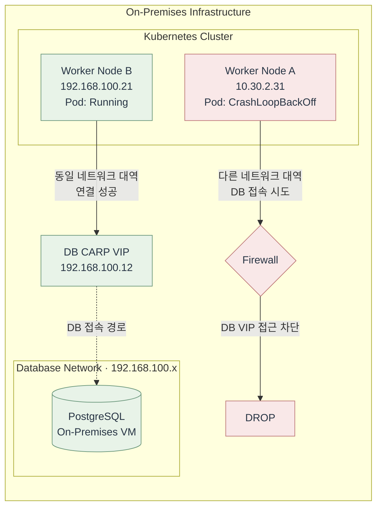

# Week 8. Kubernetes Networking Troubleshooting & Operations

## 1. 이번 주 학습 목표

지금까지 Kubernetes의 Pod Networking, Service, CNI, IPAM, NetworkPolicy, eBPF Datapath 등을 학습했다.

마지막 주차에는 운영 환경에서 발생할 수 있는 네트워크 장애를 살펴보고, **통신 경로를 기준으로 문제 발생 구간을 좁히는 방법**을 알아본다.

특히 장애 분석의 기본 점검 순서를 정리하고, 실제 프로젝트에서 경험한 네트워크 장애 사례에 적용해 본다.

---

## 2. Kubernetes에서 발생하는 주요 네트워크 장애

Kubernetes의 네트워크 장애는 Pod, Service, DNS, CNI 등 다양한 영역에서 발생한다.

대표적인 장애 유형은 다음과 같다.

| 구분 | 대표적인 증상 | 관련 구성요소 |
|---|---|---|
| CNI / IPAM | 신규 Pod의 IP 할당 실패 | CNI Plugin, IPAM, IP Pool |
| Pod Network | 다른 Node의 Pod와 통신 실패 | CNI, Routing, Overlay |
| Service | Pod IP는 접근되지만 ClusterIP는 실패 | Service, EndpointSlice, kube-proxy / eBPF LB |
| DNS | IP로는 통신되지만 이름으로 접근 실패 | CoreDNS, DNS 설정 |
| NetworkPolicy | 특정 Pod 사이의 통신 차단 | NetworkPolicy, CNI |
| External Network | Pod에서 외부 DB/API 접근 실패 | Routing, SNAT, Firewall |

비슷한 통신 장애라도 원인은 서로 다를 수 있다.

따라서 장애가 발생하면 관련 컴포넌트를 모두 확인하기보다 **어디까지 통신이 정상적으로 이루어지는지 파악하는 것이 중요하다.**

---

## 3. Kubernetes 네트워크 장애 분석 방법

### 3.1 장애 범위 확인

먼저 장애가 발생하는 범위를 확인한다.

- 특정 Pod에서만 발생하는가?
- 특정 Node에 배치된 Pod에서만 발생하는가?
- 특정 Service에서만 발생하는가?
- 클러스터 전체에서 발생하는가?

예를 들어 동일한 애플리케이션의 Pod 중 일부만 통신에 실패한다면, Pod 설정뿐 아니라 Node 배치와 네트워크 경로도 비교할 필요가 있다.

### 3.2 통신 경로 구분

Kubernetes에서 주요 통신 경로는 다음과 같다.

```text
① Pod → Pod

② Pod → Service(ClusterIP) → Backend Pod

③ Pod → CoreDNS (이름 해석)
               ↓
         Service IP 획득
               ↓
    Service(ClusterIP) → Backend Pod

④ Pod → Node Network → External
```

③은 DNS를 통해 Service IP를 확인한 후 실제 서비스 통신이 이루어지는 과정이다.

통신 경로에 따라 사용되는 구성요소가 다르므로 점검 대상도 달라진다.

### 3.3 정상 구간과 실패 구간 비교

| 정상적으로 동작하는 부분 | 문제가 발생하는 부분 | 우선 점검할 영역 |
|---|---|---|
| 같은 Node의 Pod 간 통신 | 다른 Node의 Pod 간 통신 | CNI, Routing, Overlay |
| Pod IP 직접 접근 | Service ClusterIP 접근 | Service, EndpointSlice, kube-proxy / eBPF LB |
| Service ClusterIP 접근 | Service DNS 이름으로 접근 | CoreDNS, DNS 설정 |
| NetworkPolicy 적용 전 통신 | NetworkPolicy 적용 후 통신 | NetworkPolicy, Pod Label, Security Identity |
| 기존 Pod의 네트워크 | 신규 Pod의 네트워크 구성 | CNI, IPAM, IP Pool |
| Node B에서 외부 DB 접근 | Node A에서 동일한 DB 접근 | Node별 Routing, Firewall |

이러한 비교만으로 원인을 확정할 수는 없지만, 문제가 발생한 구간을 좁히는 데 도움이 된다.

---

## 4. Kubernetes 네트워크 기본 점검 순서

네트워크 장애가 발생하면 Pod와 Node 상태를 확인한 뒤, 증상에 따라 Service, DNS, CNI 등을 점검한다.

### 4.1 Pod 상태 및 Node 배치 확인

```bash
kubectl get pods -A -o wide

kubectl describe pod <pod-name> -n <namespace>
```

확인할 내용은 다음과 같다.

- Pod의 실행 상태
- Pod IP 할당 여부
- Pod가 배치된 Node
- Events에 기록된 오류

특정 Node에 배치된 Pod만 장애가 발생한다면 해당 Node의 네트워크 환경을 추가로 확인한다.

### 4.2 Service 및 EndpointSlice 확인

```bash
kubectl get svc -A

kubectl get endpointslice -n <namespace> \
  -l kubernetes.io/service-name=<service-name>

kubectl describe svc <service-name> -n <namespace>
```

EndpointSlice는 Service가 트래픽을 전달할 Backend의 주소, Port, 상태 등의 정보를 관리하는 Kubernetes 리소스다.

다음 항목을 확인한다.

- Service Selector와 Pod Label이 일치하는가?
- EndpointSlice에 사용 가능한 Backend가 등록되어 있는가?
- Service Port와 TargetPort가 올바르게 설정되어 있는가?

Pod IP로는 접근되지만 ClusterIP로는 접근되지 않는 경우 우선적으로 점검할 수 있다.

### 4.3 DNS 및 NetworkPolicy 확인

```bash
# Pod 내부 DNS 설정 확인
cat /etc/resolv.conf

# DNS 이름 해석 확인
nslookup <service-name>.<namespace>.svc.cluster.local

# NetworkPolicy 확인 (kubectl 실행 환경)
kubectl get networkpolicy -A
```

DNS 관련 명령어는 해당 도구가 설치된 Pod 내부에서 실행한다.

이름 해석이 실패한다면 DNS 설정과 CoreDNS 상태를 확인한다.

특정 Pod 사이에서만 통신에 실패한다면 NetworkPolicy의 Selector와 Ingress/Egress 규칙을 확인한다.

### 4.4 CNI 및 Node Network 확인

```bash
# CNI DaemonSet 확인
kubectl get daemonset -n kube-system

# Cilium 사용 시
kubectl get pods -n kube-system -l k8s-app=cilium

# Node의 Routing Table 확인
ip route

# 특정 IP와 TCP Port 연결 확인
nc -zv -w3 <destination-ip> <port>
```

CNI의 종류와 설치 방식에 따라 Namespace와 Label은 달라질 수 있다.

`ip route`와 `nc`는 점검 대상 Node 등 적절한 실행 환경에서 사용한다.

특히 `nc`는 DB나 외부 API처럼 **특정 TCP Port로 연결할 수 있는지 확인**할 때 유용하다.

`ping`은 ICMP 응답을 확인하는 도구이므로, 특정 TCP Port의 정상 연결을 보장하지 않는다.

> 실제 운영에서는 모든 명령어를 순서대로 실행하기보다 장애 증상에 따라 필요한 항목부터 확인한다.

---

## 5. 실제 장애 사례: Node별 네트워크 경로 차이로 발생한 통신 장애

### 5.1 장애 상황

프로젝트에서 온프레미스 Kubernetes 환경의 오토스케일링을 검증하던 중, 목표 Replica 수와 실제 정상 가동 Replica 수가 일치하지 않는 문제가 발생했다.

일부 Pod가 DB 연결에 실패하면서 `CrashLoopBackOff`를 반복했다.

특이한 점은 **동일한 이미지와 설정을 사용하더라도 특정 Node에 배치된 Pod에서만 장애가 발생했다는 것**이다.

당시 PostgreSQL은 Kubernetes 내부가 아닌 별도의 온프레미스 VM에서 운영되고 있었다.



Node A는 DB와 다른 네트워크 대역에 있어 방화벽을 경유해야 했지만, Node B는 DB와 동일한 대역에서 정상적으로 통신할 수 있었다.

### 5.2 원인 분석

**① 애플리케이션과 DB 상태 확인**

처음에는 DB 자체의 장애나 애플리케이션 설정 문제를 의심했다.

하지만 DB는 정상적으로 동작하고 있었고, 다른 Node에 배치된 Pod는 동일한 설정으로 정상 기동하고 있었다.

**② Node별 DB 연결 비교**

각 Node에서 애플리케이션이 실제 사용하는 DB 주소와 Port로 연결을 테스트했다.

```bash
nc -zv -w3 <db-address> <db-port>
```

확인 결과는 다음과 같았다.

| 구분 | DB 연결 결과 |
|---|---|
| Node A | Timeout |
| Node B | 정상 연결 |

이를 통해 DB 자체의 장애보다는 **Node별 네트워크 경로에 차이가 있을 가능성**을 확인했다.

**③ Routing 및 Firewall 확인**

두 Node는 서로 다른 네트워크 대역에 배치되어 있었다.

Node A에서 DB로 접근하려면 방화벽을 경유해야 했지만, 해당 경로에 필요한 허용 정책이 누락되어 있었다.

반면 Node B는 DB와 동일한 네트워크 대역에 있어 해당 방화벽을 경유하지 않고 통신할 수 있었다.

방화벽 로그에서 Node A의 DB 연결 요청이 차단되는 것을 확인했다.

### 5.3 원인 및 해결

**원인은 Node별 네트워크 경로 차이와 방화벽 허용 정책 누락이었다.**

실제 애플리케이션이 사용하는 DB 접속 주소와 Port가 방화벽의 허용 목록에서 누락되어 있었다.

해당 주소와 Port를 허용 목록에 추가한 뒤 DB 연결이 정상적으로 이루어졌고, Pod가 정상 기동하면서 목표 Replica 수와 실제 가동 Replica 수가 일치했다.

### 5.4 배운 점

이 사례에서 확인한 직접적인 원인은 Kubernetes 내부의 CNI나 IPAM 설정 오류가 아닌, **Node와 DB 사이의 방화벽 정책 문제**였다.

Kubernetes Scheduler는 Pod를 여러 Node에 배치할 수 있지만, 각 Node에서 외부 시스템까지의 연결 가능성을 항상 보장하지는 않는다.

따라서 동일한 이미지와 설정을 사용하는 Pod라도 **배치된 Node의 Routing과 Firewall 구성에 따라 통신 결과가 달라질 수 있다.**

일부 Pod에서만 장애가 발생한다면 Pod 자체의 상태와 함께 **Node 배치 및 실제 목적지까지의 네트워크 경로를 비교**해야 한다.

---

## 6. 정리

Kubernetes 네트워크 장애는 CNI, Service, DNS, NetworkPolicy, Routing 등 다양한 영역에서 발생할 수 있다.

장애 원인을 분석할 때는 다음 과정을 기준으로 접근할 수 있다.

```text
네트워크 장애 발생
        ↓
장애 범위 확인
(Pod / Node / Service / Cluster)
        ↓
통신 경로 구분
        ↓
정상 구간과 실패 구간 비교
        ↓
관련 구성요소 점검
        ↓
원인 확인 및 대응
```

특히 **같은 설정의 Pod라도 배치된 Node의 네트워크 환경에 따라 통신 결과가 달라질 수 있다.**

따라서 Kubernetes 네트워크를 운영할 때는 Pod와 Service의 설정뿐 아니라 Node별 Routing, Firewall, 외부 시스템까지의 연결 경로를 함께 고려해야 한다.

---

## 참고 자료

- Kubernetes - Debug Services  
  https://kubernetes.io/docs/tasks/debug/debug-application/debug-service/

- Kubernetes - Debugging DNS Resolution  
  https://kubernetes.io/docs/tasks/administer-cluster/dns-debugging-resolution/

- Cilium - Troubleshooting  
  https://docs.cilium.io/en/stable/operations/troubleshooting/